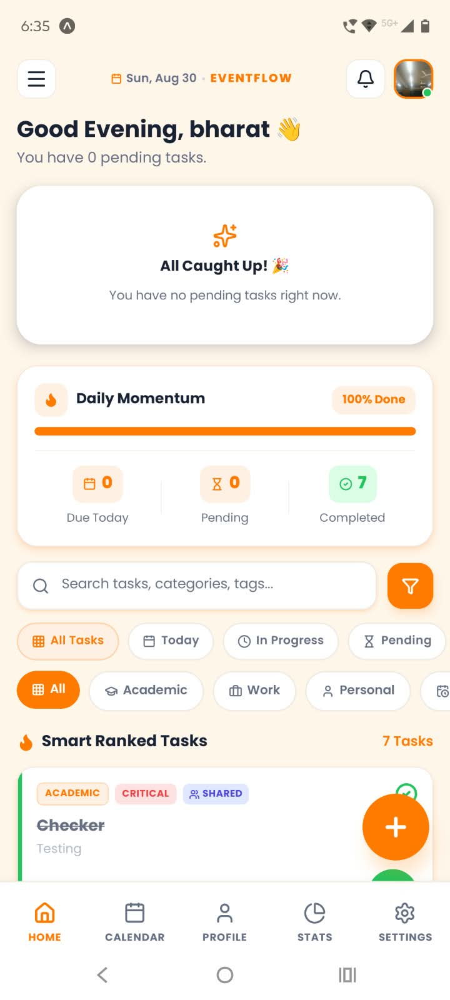
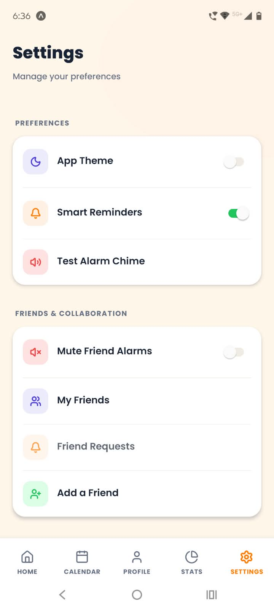
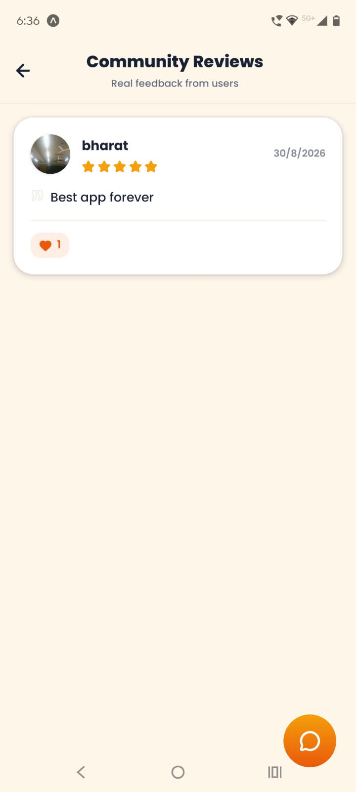
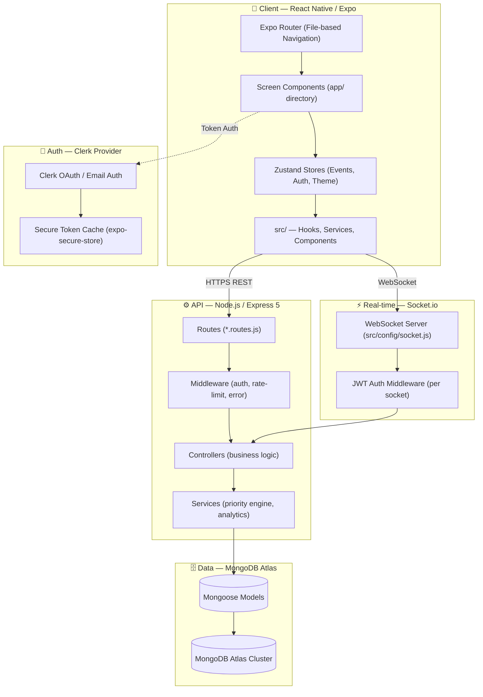
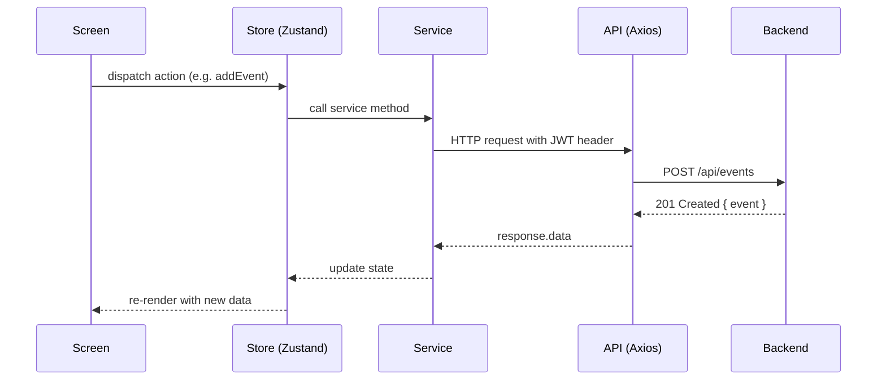
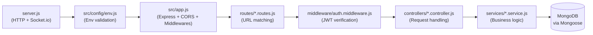

<div align="center">

  

  <h1>EventFlow</h1>

  <p>
    A full-stack, production-ready mobile productivity platform —<br/>
    smart event scheduling, AI priority ranking, real-time social features, and native alarm management.
  </p>

  <p>
    <a href="https://github.com/priyabratasahoo780/EventFlow/stargazers">
      
    </a>
    <a href="https://github.com/priyabratasahoo780/EventFlow/commits/main">
      
    </a>
    <a href="https://github.com/priyabratasahoo780/EventFlow/blob/main/LICENSE">
      
    </a>
    
    
    
  </p>

  <br/>

  | Welcome | Login | Home | Calendar |
  |:-:|:-:|:-:|:-:|
  |  |  |  |  |

  | Statistics | Settings | Community | Friends |
  |:-:|:-:|:-:|:-:|
  |  |  |  |  |

</div>

---

## Table of Contents

- [Overview](#overview)
- [Key Features](#key-features)
- [Complete Feature Overview](#-complete-feature-overview)
- [EventFlow vs. The Market](#️-eventflow-vs-the-market)
- [Tech Stack](#tech-stack)
- [Architecture](#architecture)
- [Project Structure](#project-structure)
- [Getting Started](#getting-started)
  - [Prerequisites](#prerequisites)
  - [Backend Setup](#backend-setup)
  - [Frontend Setup](#frontend-setup)
  - [Environment Variables](#environment-variables)
- [API Reference](#api-reference)
- [Folder Structure Deep Dive](#folder-structure-deep-dive)
- [Roadmap](#roadmap)
- [Contributing](#contributing)
- [License](#license)
- [Author](#author)

---

## Overview

**EventFlow** is a production-grade mobile application that goes far beyond a simple to-do list. It combines **smart event scheduling**, a **priority scoring engine**, **native Android alarm management**, **geofence-based location reminders**, and **real-time social features** into a single cohesive experience.

Built on a **React Native + Expo** frontend and a **Node.js + Express + MongoDB** backend, with a clean domain-driven folder architecture and zero TypeScript errors.

---

## Key Features

### 📅 Event & Task Management
- Create events with **rich metadata**: category, priority, estimated duration, color, icon, linked contact, media (image/video)
- **Multi-reminder system** per event: `before`, `exact`, `daily`, `weekly`, `monthly`, `yearly`
- Smart status tracking: `pending → in_progress → completed → overdue`

### 🧠 AI Priority Engine
- Dynamic priority scoring based on **deadline proximity**, **user-defined importance**, and **location distance**
- Auto-ranked task list and **Hero Focus Card** carousel on the home screen
- Backend `/api/tasks/recommendation` endpoint for server-side priority suggestions

### 🔔 Native Alarm & Notification System (Offline-First)
- **100% Offline Capable**: Alarms fire precisely on time even if the app is completely closed (killed) or offline.
- **Dual-layer alert system**: `expo-notifications` for standard push/local banners + custom `AlarmManagerModule` (Kotlin) for **exact Android alarms**.
- **Deep Sleep Wake-Up**: Leverages Android `PowerManager.WakeLock` to turn the screen on and bypass Doze mode.
- Alarm modal with continuous looping sound, haptic feedback, and a snooze-like dismiss button.
- Graceful fallback on iOS and Expo Go.

### 📍 Geofence Location Reminders
- Enable a **location trigger** per event: fire a reminder when you **arrive at** or **leave** the event location
- Powered by `expo-location` background task + custom geofencing engine
- Visual `LocationArrivalModal` with navigation shortcut

### 👥 Social & Friends
- Add friends by username/email with a **request → accept → connect** flow
- Share events with friends (visibility: `onlyMe`, `friends`, `selectedFriends`)
- Real-time friend event feed via **Socket.io**
- In-app DM messaging between friends

### 📊 Analytics Dashboard
- Weekly productivity charts (gifted-charts)
- Category breakdown and completion trends
- Daily momentum progress bar on home screen

### 🎨 Premium UI
- Brutalist-inspired design system with custom `BrutalCard` and `BrutalButton` components
- Dark/Light theme via `useThemeStore`
- Smooth animations (Reanimated 4), haptic feedback on every interaction
- Hero card carousel with auto-scroll, category chips, status filter pills

---

## 🗂️ Complete Feature Overview

> Every feature shipped in the current production build.

### 📅 Event & Task Management

| Feature | Description | Status |
|:---|:---|:---:|
| Rich event creation | Category, priority, duration, color, icon, linked contact, media (image/video) | ✅ |
| Multi-reminder system | Per-event reminders: `before`, `exact`, `daily`, `weekly`, `monthly`, `yearly` | ✅ |
| Smart status lifecycle | `pending → in_progress → completed → overdue` with visual indicators | ✅ |
| Event detail screen | Full-page dynamic screen (`/event/[id]`) with edit & delete | ✅ |
| Add Event screen | Full-form screen with all fields, validation, and media upload | ✅ |
| Task Triage view | Bulk-manage overdue/pending tasks from a dedicated triage screen | ✅ |
| Calendar view | Monthly/weekly visual calendar with event dots and filters | ✅ |
| Category chips & filters | Filter events by category, status, or priority on the home screen | ✅ |
| Hero Focus Card carousel | Auto-scrolling top 3 AI-ranked events as full-bleed hero cards | ✅ |

---

### 🧠 AI Priority Engine

| Feature | Description | Status |
|:---|:---|:---:|
| Dynamic priority scoring | Weighs **deadline proximity**, **user-defined importance**, and **location distance** | ✅ |
| Server-side recommendation | `/api/tasks/recommendation` returns top-ranked task | ✅ |
| Client-side ranking | Instant re-rank on Zustand state changes without API call | ✅ |
| Overdue auto-detection | Backend cron-style check; status flips to `overdue` automatically | ✅ |

---

### 🔔 Alarm & Notification System

| Feature | Description | Status |
|:---|:---|:---:|
| Local push notifications | `expo-notifications` banners with sound (all platforms, foreground + background) | ✅ |
| Native Android exact alarms | Custom `AlarmManagerModule` (Kotlin) — fires precisely on time even if app is killed | ✅ |
| Deep sleep wake-up | `PowerManager.WakeLock` bypasses Android Doze mode; screen turns on | ✅ |
| Alarm modal UI | Looping alarm sound, haptics, animated dismiss button | ✅ |
| Multi-reminder support | Schedule multiple alarm times per single event | ✅ |
| Expo Go graceful fallback | Fallback to standard notifications when native module unavailable | ✅ |

---

### 📍 Geofence & Location

| Feature | Description | Status |
|:---|:---|:---:|
| Location trigger per event | Enable arrive-at / leave-location reminders | ✅ |
| Background geofencing | `expo-location` background task + custom geofencing engine | ✅ |
| Location Arrival Modal | In-app overlay with map shortcut when you enter the event zone | ✅ |
| Full-screen map view | `/map` screen with event pins and geofence radius circles | ✅ |
| Location selector | Pick event location from map directly inside the Add Event flow | ✅ |

---

### 👥 Social & Friends

| Feature | Description | Status |
|:---|:---|:---:|
| Friend discovery | Search by username or email | ✅ |
| Request → Accept → Connect | Full friend request lifecycle with reject support | ✅ |
| Event sharing | Share events with visibility: `onlyMe`, `friends`, `selectedFriends` | ✅ |
| Real-time friend event feed | Friends' shared events streamed via Socket.io | ✅ |
| In-app DM messaging | Direct messages between connected friends | ✅ |
| Remove friend | Unfriend with confirmation | ✅ |

---

### 💬 Community

| Feature | Description | Status |
|:---|:---|:---:|
| Public reviews feed | Users post reviews visible to the whole community | ✅ |
| Like / toggle reactions | Tap to like or unlike any community review | ✅ |
| Review creation | Rich text review submission from the Community screen | ✅ |

---

### 📊 Analytics Dashboard

| Feature | Description | Status |
|:---|:---|:---:|
| Weekly productivity chart | Bar chart of events completed per day (gifted-charts) | ✅ |
| Category breakdown | Pie/segment breakdown by event category | ✅ |
| Completion trend | Historical trend of task completion rate | ✅ |
| Daily momentum bar | Home screen progress bar showing today's completion % | ✅ |
| Dashboard API | `/api/analytics/dashboard`, `/weekly`, `/categories` endpoints | ✅ |

---

### 🎨 UI & Experience

| Feature | Description | Status |
|:---|:---|:---:|
| Animated Splash Screen | Custom `SplashScreenView` with branded animation sequence | ✅ |
| Dark / Light theme | System-aware + manual toggle via `useThemeStore` | ✅ |
| Haptic feedback | Every tap triggers haptic via `expo-haptics` | ✅ |
| Smooth animations | Reanimated 4 — shared values, layout transitions, spring physics | ✅ |
| BrutalCard / BrutalButton | Custom design-system primitives used across all screens | ✅ |
| Responsive layout | Scales cleanly across phone sizes (portrait only) | ✅ |
| Media picker | Image & video picker with preview (Expo ImagePicker) | ✅ |
| Offline-first alarms | Alarms work 100% without internet | ✅ |

---

## ⚔️ EventFlow vs. The Market

> How EventFlow stacks up against the most popular event & calendar apps available today.

| Feature | **EventFlow** | Google Calendar | Apple Calendar | Todoist | TickTick | Any.do |
|:---|:---:|:---:|:---:|:---:|:---:|:---:|
| **Smart AI Priority Ranking** | ✅ Built-in | ❌ | ❌ | ✅ Basic | ✅ Basic | ❌ |
| **Native Exact Alarms (bypasses Doze)** | ✅ Custom Kotlin module | ❌ | ❌ | ❌ | ❌ | ❌ |
| **Deep-sleep Screen Wake-up** | ✅ WakeLock | ❌ | ❌ | ❌ | ❌ | ❌ |
| **Multi-type reminders per event** | ✅ 6 types | ✅ 3 types | ✅ 2 types | ✅ (premium) | ✅ (premium) | ✅ (premium) |
| **Geofence Location Reminders** | ✅ Arrive & Leave | ✅ Arrive only | ❌ | ❌ | ✅ (premium) | ✅ (premium) |
| **Real-time Social Event Feed** | ✅ Socket.io | ❌ | ❌ | ❌ | ❌ | ❌ |
| **In-app Friend Messaging (DM)** | ✅ | ❌ | ❌ | ❌ | ❌ | ❌ |
| **Friend Request System** | ✅ | ❌ | ❌ | ❌ | ❌ | ❌ |
| **Community Reviews Feed** | ✅ | ❌ | ❌ | ❌ | ❌ | ❌ |
| **Event Media (Image / Video)** | ✅ | ❌ | ❌ | ✅ image only | ✅ image only | ❌ |
| **Weekly Analytics Dashboard** | ✅ Custom charts | ✅ Basic | ❌ | ✅ (premium) | ✅ (premium) | ❌ |
| **Task Triage Screen** | ✅ | ❌ | ❌ | ✅ | ✅ | ✅ |
| **Hero Focus Card (top event)** | ✅ | ❌ | ❌ | ✅ | ❌ | ✅ (premium) |
| **Full-screen Map with Event Pins** | ✅ | ✅ | ✅ | ❌ | ❌ | ❌ |
| **Open Source & Self-hostable** | ✅ MIT | ❌ | ❌ | ❌ | ❌ | ❌ |
| **Zero Subscription / Free Forever** | ✅ | ✅ (basic) | ✅ | ❌ (freemium) | ❌ (freemium) | ❌ (freemium) |
| **Offline-first Alarm Engine** | ✅ | ⚠️ partial | ⚠️ partial | ⚠️ partial | ⚠️ partial | ⚠️ partial |

### 🏆 What Makes EventFlow Unique

> These capabilities **do not exist** in any mainstream calendar or productivity app on the market today:

| Unique Capability | Why It Matters |
|:---|:---|
| 🔋 **Native Android WakeLock Alarm** | Most apps rely on OS notifications which can be silenced by battery optimization. EventFlow wakes the screen and plays sound even when the app is force-killed — like a real alarm clock. |
| 🤝 **Social Event Sharing with Real-time Feed** | No other calendar app has a friend-based event feed with Socket.io live updates. Share your events with specific friends the way you'd share a post. |
| 💬 **In-app DM between friends** | Combined in a single event app — no need to switch to WhatsApp to coordinate plans. |
| 🧠 **Multi-factor AI Priority Engine** | Priority is calculated from 3 signals simultaneously: time to deadline, user importance, and physical distance to location. |
| 🌍 **Arrive AND Leave geofence triggers** | TickTick and Any.do only support arrive; EventFlow fires reminders on both arrival and departure. |
| 💬 **Public Community Reviews** | A social review feed inside a productivity app — first of its kind in this category. |
| 🆓 **100% Free, Open Source, Self-hostable** | Todoist, TickTick, and Any.do all charge for premium features. EventFlow is MIT-licensed with no paywalls. |

---

## Tech Stack

### Frontend

| Technology | Version | Role |
|:---|:---:|:---|
|  | 0.86 | Core mobile framework |
|  | 57 | Build, OTA, native modules |
|  | 6.x | Strict type safety |
|  | v4 | File-based navigation |
|  | 5.x | Lightweight global state |
|  | 4.x | Authentication & JWT |
|  | 4.x | Real-time events |
| Axios | 1.x | HTTP client |
| React Native Maps | 1.27 | Maps + geofence display |
| Reanimated | 4.x | Smooth animations |

**Key Expo modules:** `expo-notifications`, `expo-location`, `expo-task-manager`, `expo-video`, `expo-audio`, `expo-haptics`, `expo-image-picker`, `expo-secure-store`

### Backend

| Technology | Version | Role |
|:---|:---:|:---|
|  | 18+ | Runtime |
|  | 5.x | REST framework |
|  | Atlas | Primary database |
|  | 9.x | ODM / schema validation |
|  | 4.x | WebSocket server |
| JWT | 9.x | Stateless auth tokens |
| bcryptjs | 3.x | Password hashing |
| Multer | 2.x | File upload handling |
| expo-server-sdk | 7.x | Expo push notifications |
| express-rate-limit | 8.x | API rate limiting |

---

## Architecture

### System Overview



### Frontend Request Flow



### Backend Request Pipeline



---

## Project Structure

```
EventFlow/                              # Mono-repo root
├── backend/                            # Node.js + Express API
│   ├── server.js                       # Entry point (HTTP + Socket.io bootstrap)
│   └── src/
│       ├── config/
│       │   ├── db.js                   # MongoDB connection
│       │   ├── env.js                  # Env validation (fail-fast)
│       │   └── socket.js               # Socket.io setup (extracted from server)
│       ├── constants/
│       │   └── index.js                # HTTP codes, error messages, status enums
│       ├── controllers/                # One file per domain, dot.notation naming
│       │   ├── auth.controller.js
│       │   ├── event.controller.js
│       │   ├── friend.controller.js
│       │   ├── task.controller.js
│       │   ├── analytics.controller.js
│       │   ├── review.controller.js
│       │   ├── upload.controller.js
│       │   └── user.controller.js
│       ├── middleware/
│       │   ├── auth.middleware.js      # JWT verification
│       │   ├── error.middleware.js     # Global error handler
│       │   ├── rateLimiter.js          # API + auth rate limits
│       │   └── upload.middleware.js    # Multer config
│       ├── models/                     # Mongoose schemas
│       │   ├── Event.js
│       │   ├── FriendRequest.js
│       │   ├── Message.js
│       │   ├── Review.js
│       │   └── User.js
│       ├── routes/                     # Consistent *.routes.js naming
│       │   ├── auth.routes.js
│       │   ├── event.routes.js
│       │   ├── friend.routes.js
│       │   ├── task.routes.js
│       │   ├── analytics.routes.js
│       │   ├── review.routes.js
│       │   ├── upload.routes.js
│       │   └── user.routes.js
│       ├── services/
│       │   ├── analytics.service.js
│       │   └── priority.service.js     # Dynamic priority scoring engine
│       ├── utils/
│       │   ├── ApiError.js             # Custom error class
│       │   └── logger.js               # Structured logger (ISO timestamps)
│       └── validators/
│           ├── auth.validator.js
│           └── task.validator.js
│
└── frontend/                           # React Native + Expo app
    ├── app/                            # Expo Router file-based routing
    │   ├── (auth)/                     # Auth group: welcome, login, register
    │   ├── (tabs)/                     # Tab group: home, calendar, stats, profile, settings
    │   ├── event/[id].tsx              # Dynamic event detail screen
    │   ├── friends/                    # Friends: connect, list, requests
    │   ├── community/                  # Community reviews
    │   ├── map.tsx                     # Full-screen map view
    │   └── _layout.tsx                 # Root layout (ClerkProvider, fonts, themes)
    │
    ├── src/                            # All application source code
    │   ├── components/                 # Domain-grouped UI components
    │   │   ├── alarm/                  # AlarmModal
    │   │   ├── events/                 # EventCard, FocusRecommendationCard, CategoryChip
    │   │   ├── home/                   # Home screen sub-components (extracted god file)
    │   │   ├── location/               # LocationArrivalModal, LocationSelector, MapViewWrapper
    │   │   ├── media/                  # MediaPicker
    │   │   └── ui/                     # Generic: BrutalButton, BrutalCard, Input, Header…
    │   │
    │   ├── constants/                  # Colors, theme tokens, responsive helpers
    │   ├── hooks/                      # Custom React hooks (useLocation, useHomeScreen…)
    │   ├── lib/                        # Third-party wrappers (notifications.ts shim)
    │   ├── services/                   # API calls + native services
    │   │   └── alarm/                  # alarmService.ts, alarmSoundService.ts
    │   ├── store/                      # Zustand stores (useEventStore, useAuthStore…)
    │   └── types/                      # Shared TypeScript types (event.types.ts)
    │
    ├── assets/                         # Fonts, images, icons
    ├── android_backup/                 # Custom Native Android Modules (Kotlin Alarms)
    ├── plugins/                        # Expo config plugins (Injects android_backup)
    ├── babel.config.js                 # @/* path aliases via module-resolver
    ├── tsconfig.json                   # Strict TS + path aliases
    ├── metro.config.js                 # Metro bundler config + web shims
    └── app.json                        # Expo app config (EAS, permissions)
```

---

## Getting Started

### Prerequisites

| Tool | Version | Notes |
|:---|:---|:---|
| Node.js | **≥ 18.x** | [nodejs.org](https://nodejs.org) |
| npm | **≥ 9.x** | Bundled with Node.js |
| MongoDB | Local or Atlas | [mongodb.com/cloud/atlas](https://www.mongodb.com/cloud/atlas) |
| Expo Go App | Latest | Scan QR for quick testing (Android/iOS) |
| Android Studio | Optional | For full native build / emulator |

> **Important:** The native `AlarmManagerModule` (exact Android alarms) only works in a custom development build or APK, **not** in Expo Go. All other features run in Expo Go.

---

### Clone the Repository

```bash
git clone https://github.com/priyabratasahoo780/EventFlow.git
cd EventFlow
```

---

### Backend Setup

```bash
cd backend

# Install dependencies
npm install

# Copy and configure environment variables
cp .env.example .env
# → Edit .env with your values (see Environment Variables section below)

# Start development server with hot-reload
npm run dev
# → Server starts at http://localhost:5000
```

**Available scripts:**

| Script | Description |
|:---|:---|
| `npm run dev` | Start with nodemon (hot-reload) |
| `npm start` | Start in production mode |

---

### Frontend Setup

```bash
cd frontend

# Install dependencies
npm install

# Start the Expo development server (with cache clear)
npx expo start -c

# Platform-specific launchers:
npm run android   # Android emulator / physical device
npm run ios       # iOS simulator (macOS only)
npm run web       # Web browser (limited native features)

# Production build (EAS):
npm run build:apk  # Android APK via EAS Build
```

**Available scripts:**

| Script | Description |
|:---|:---|
| `npm start` | Start Expo dev server |
| `npm run android` | Run on Android |
| `npm run ios` | Run on iOS |
| `npm run web` | Run in browser |
| `npm run build:apk` | EAS build (Android APK) |

> Scan the QR code shown in the terminal with the **Expo Go** app to test instantly on a physical device.

---

### Environment Variables

#### Backend — `backend/.env`

```env
# Server
PORT=5000
NODE_ENV=development

# Database
MONGO_URI=mongodb+srv://<user>:<password>@cluster.mongodb.net/eventflow

# Authentication
JWT_SECRET=your_super_secret_jwt_key_min_32_chars

# Expo Push Notifications (optional)
EXPO_ACCESS_TOKEN=your_expo_access_token
```

> **Required fields** (server will throw at startup if missing): `MONGO_URI`, `JWT_SECRET`

#### Frontend — `frontend/.env` (if needed)

```env
EXPO_PUBLIC_API_URL=http://localhost:5000
EXPO_PUBLIC_CLERK_PUBLISHABLE_KEY=pk_test_your_clerk_key
```

> Variables prefixed with `EXPO_PUBLIC_` are safe to embed in the client bundle.

---

## API Reference

> All protected endpoints require: `Authorization: Bearer <jwt_token>`

### Auth — `/api/auth`

| Method | Endpoint | Protected | Description |
|:---:|:---|:---:|:---|
| `POST` | `/api/auth/register` | ✗ | Register a new user (email + password) |
| `POST` | `/api/auth/login` | ✗ | Login and receive JWT |
| `POST` | `/api/auth/google` | ✗ | Login with Google OAuth |
| `POST` | `/api/auth/sync` | ✗ | Sync Clerk user with MongoDB |
| `POST` | `/api/auth/forgot-password` | ✗ | Send password reset email |
| `GET` | `/api/auth/profile` | ✓ | Get authenticated user's profile |

### Users — `/api/users`

| Method | Endpoint | Protected | Description |
|:---:|:---|:---:|:---|
| `GET` | `/api/users/profile` | ✓ | Get current user profile |
| `PUT` | `/api/users/profile` | ✓ | Update user profile |
| `POST` | `/api/users/push-token` | ✓ | Register Expo push notification token |

### Events — `/api/events`

| Method | Endpoint | Protected | Description |
|:---:|:---|:---:|:---|
| `POST` | `/api/events` | ✓ | Create a new event |
| `GET` | `/api/events` | ✓ | Get all events for current user |
| `GET` | `/api/events/friends` | ✓ | Get shared events from friends |

### Tasks — `/api/tasks`

| Method | Endpoint | Protected | Description |
|:---:|:---|:---:|:---|
| `GET` | `/api/tasks` | ✓ | Get all tasks (sorted by priority) |
| `GET` | `/api/tasks/recommendation` | ✓ | Get top AI-ranked task recommendation |
| `POST` | `/api/tasks` | ✓ | Create a new task |
| `GET` | `/api/tasks/:id` | ✓ | Get task by ID |
| `PUT` | `/api/tasks/:id` | ✓ | Update task details |
| `PATCH` | `/api/tasks/:id/status` | ✓ | Update task status only |
| `DELETE` | `/api/tasks/:id` | ✓ | Delete a task |

### Friends — `/api/friends`

| Method | Endpoint | Protected | Description |
|:---:|:---|:---:|:---|
| `POST` | `/api/friends/search` | ✓ | Search user by name or email |
| `POST` | `/api/friends/request` | ✓ | Send a friend request |
| `GET` | `/api/friends/requests` | ✓ | Get incoming friend requests |
| `POST` | `/api/friends/accept` | ✓ | Accept a friend request |
| `POST` | `/api/friends/reject` | ✓ | Reject a friend request |
| `GET` | `/api/friends` | ✓ | Get full friends list |
| `GET` | `/api/friends/events` | ✓ | Get friends' shared events |
| `POST` | `/api/friends/message` | ✓ | Send a DM to a friend |
| `GET` | `/api/friends/messages/:friendId` | ✓ | Get message history with a friend |
| `DELETE` | `/api/friends/remove` | ✓ | Remove a friend |

### Reviews — `/api/reviews`

| Method | Endpoint | Protected | Description |
|:---:|:---|:---:|:---|
| `POST` | `/api/reviews` | ✓ | Create a community review |
| `GET` | `/api/reviews` | ✓ | Get all community reviews |
| `POST` | `/api/reviews/:id/like` | ✓ | Toggle like on a review |

### Analytics — `/api/analytics`

| Method | Endpoint | Protected | Description |
|:---:|:---|:---:|:---|
| `GET` | `/api/analytics/dashboard` | ✓ | Dashboard summary statistics |
| `GET` | `/api/analytics/weekly` | ✓ | Weekly productivity chart data |
| `GET` | `/api/analytics/categories` | ✓ | Task breakdown by category |

### Uploads — `/api/upload`

| Method | Endpoint | Protected | Description |
|:---:|:---|:---:|:---|
| `POST` | `/api/upload/image` | ✓ | Upload image (50MB max) |
| `POST` | `/api/upload/video` | ✓ | Upload video (50MB max) |
| `DELETE` | `/api/upload/:id` | ✓ | Delete an uploaded file |

---

## Folder Structure Deep Dive

### Path Aliases (Frontend)

The frontend uses Babel `module-resolver` so imports are clean and refactor-safe:

```typescript
// ❌ Before (brittle relative paths)
import { useEventStore } from '../../../../store/useEventStore';
import BrutalButton from '../../components/BrutalButton';

// ✅ After (clean path aliases)
import { useEventStore } from '@/store';
import { BrutalButton } from '@/components/ui';
```

| Alias | Resolves to |
|:---|:---|
| `@/*` | `./src/*` |
| `@/components` | `./src/components` |
| `@/store` | `./src/store` |
| `@/hooks` | `./src/hooks` |
| `@/services` | `./src/services` |
| `@/types` | `./src/types` |
| `@/constants` | `./src/constants` |
| `@/lib` | `./src/lib` |

### Barrel Exports

Every `src/` subdirectory has an `index.ts` barrel for clean tree-shakable imports:

```typescript
// Single import for all UI primitives
import { BrutalButton, BrutalCard, LoadingScreen, EmptyState } from '@/components/ui';

// Single import for all stores
import { useEventStore, useAuthStore, useThemeStore } from '@/store';
```

### Notification Architecture

```
Notification triggered
  ├── expo-notifications → Banner + sound (all platforms, foreground)
  └── AlarmManagerModule (Kotlin) → Exact alarm (Android, even background/killed)
        └── AlarmModal fires on exact time match via 1-second foreground poll
```

---

## Roadmap

- [x] Multi-reminder system (before/exact/daily/weekly/monthly/yearly)
- [x] Native Android AlarmManager integration
- [x] Geofence location reminders (arrive/leave)
- [x] Real-time friend events via Socket.io
- [x] AI priority scoring engine
- [x] Production-ready folder structure with path aliases
- [ ] Push notifications via Expo server SDK
- [ ] Group events and collaborative task lists
- [ ] Offline mode with AsyncStorage-first sync
- [ ] EAS Update (OTA updates in production)
- [ ] End-to-end encrypted DMs
- [ ] Widget support (Android/iOS)

---

## Contributing

Contributions are what make open source amazing. Any contribution you make is **greatly appreciated**.

1. **Fork** the repository
2. Create your feature branch: `git checkout -b feat/amazing-feature`
3. Commit your changes: `git commit -m 'feat: add amazing feature'`
4. Push to the branch: `git push origin feat/amazing-feature`
5. Open a **Pull Request**

**Commit message format** (Conventional Commits):

| Prefix | When to use |
|:---|:---|
| `feat:` | New feature |
| `fix:` | Bug fix |
| `refactor:` | Code restructure (no feature change) |
| `docs:` | Documentation only |
| `chore:` | Build/tooling changes |

---

## License

Distributed under the **MIT License**. See [`LICENSE`](LICENSE) for more information.

---

## Author

<div align="center">

**Priyabrata Sahoo**

[](https://github.com/priyabratasahoo780)
[](https://github.com/priyabratasahoo780/EventFlow/issues)

---

<sub>Built with ❤️ passion and precision.</sub>


<br/><br/>
<sub>© 2026 EventFlow — All rights reserved.</sub>

</div>