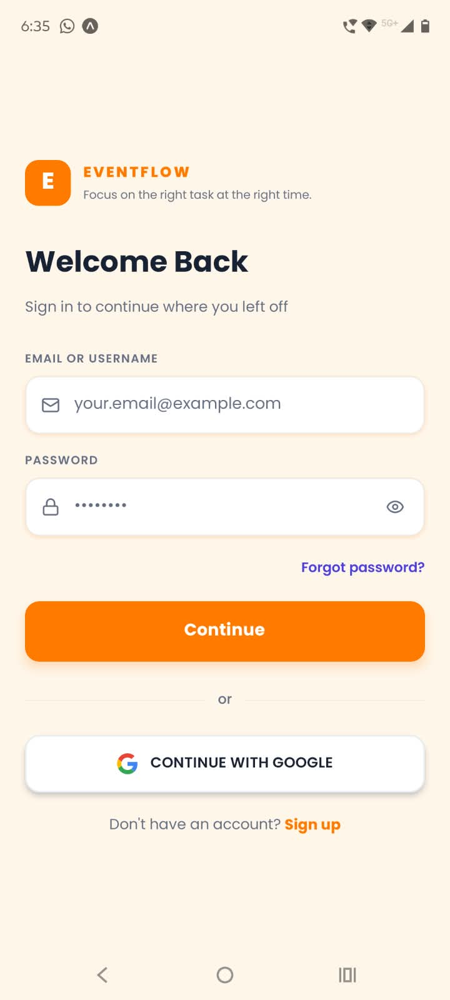
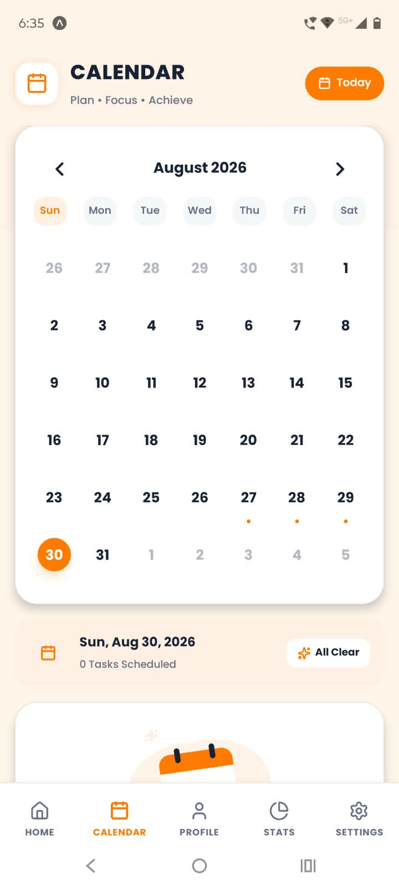
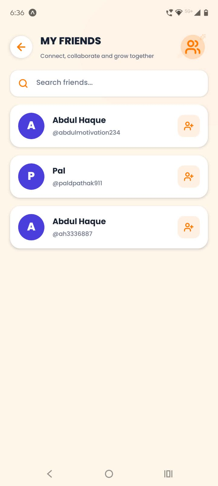
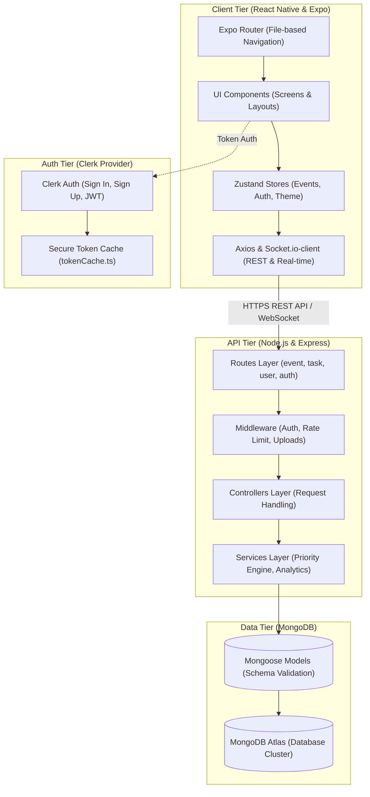
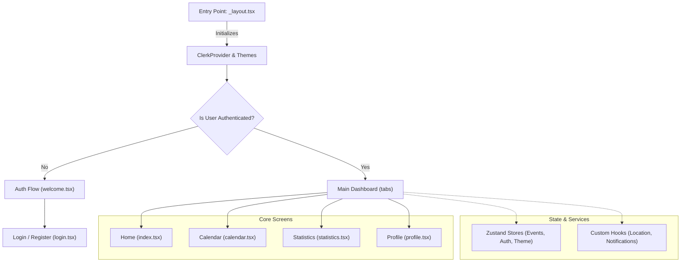
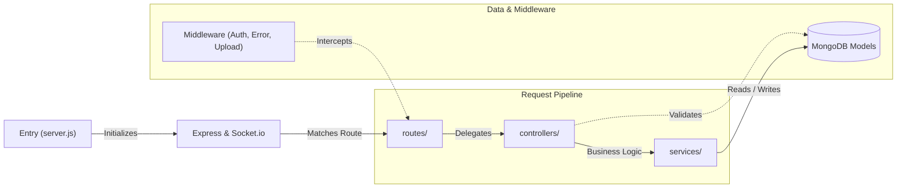

<div align="center">
  
  <h1>EventFlow</h1>
  <p>A comprehensive event scheduling, task management, and productivity tracking application.</p>
</div>

---

## About The App

EventFlow (also known as FocusFlow) is a full-stack mobile application designed to help users take control of their time. It combines calendar event scheduling, task prioritization, location-based tracking, and social connections into a single, seamless brutalist-styled interface.

Whether you are managing daily routines, organizing community events, or collaborating with friends, EventFlow keeps you on track with real-time notifications and smart priority algorithms.

---

## App Preview

<div align="center">

| Welcome | Login | Home | Calendar |
|:-:|:-:|:-:|:-:|
|  |  |  |  |

| Statistics | Settings | Community | Friends |
|:-:|:-:|:-:|:-:|
|  |  |  |  |

</div>

---

## Tech Stack

### Frontend (Mobile App)


<br/>
**Libraries:** Clerk Auth (`@clerk/expo`), Zustand, Axios, Socket.io-client, React Native Maps, Custom Brutalist UI

### Backend (REST API)


<br/>
**Features:** JWT Auth, bcrypt, Multer (Uploads), Socket.io (Real-time), Express Rate Limit

---

## Workflow Structure

### Full Stack System Design

The platform operates on a **4-tier mobile architecture** spanning the mobile client, authentication provider, API server, and MongoDB database cluster. Every component is purpose-built for high-performance event and task management at scale.



The project is organized into a clean mono-repo structure containing both the frontend and backend applications, designed for independent scaling and development.

### Frontend Workflow



### Backend Workflow



---

## API Endpoints

> All protected routes require a valid **JWT Bearer Token** in the `Authorization` header.

### Auth — `/api/auth`

| Method | Endpoint | Auth | Description |
|:---:|---|:---:|---|
| `POST` | `/api/auth/register` | No | Register a new user |
| `POST` | `/api/auth/login` | No | Login with email and password |
| `POST` | `/api/auth/google` | No | Login with Google OAuth |
| `POST` | `/api/auth/sync` | No | Sync Clerk user with database |
| `POST` | `/api/auth/forgot-password` | No | Send password reset email |
| `GET` | `/api/auth/profile` | Yes | Get logged-in user profile |

### User — `/api/users`

| Method | Endpoint | Auth | Description |
|:---:|---|:---:|---|
| `GET` | `/api/users/profile` | Yes | Get current user's profile |
| `PUT` | `/api/users/profile` | Yes | Update user profile details |
| `POST` | `/api/users/push-token` | Yes | Register Expo push token |

### Events — `/api/events`

| Method | Endpoint | Auth | Description |
|:---:|---|:---:|---|
| `POST` | `/api/events` | Yes | Create a new event |
| `GET` | `/api/events` | Yes | Get all events for current user |
| `GET` | `/api/events/friends` | Yes | Get events from friends |

### Tasks — `/api/tasks`

| Method | Endpoint | Auth | Description |
|:---:|---|:---:|---|
| `GET` | `/api/tasks` | Yes | Get all tasks |
| `GET` | `/api/tasks/recommendation` | Yes | Get AI priority recommendations |
| `POST` | `/api/tasks` | Yes | Create a new task |
| `GET` | `/api/tasks/:id` | Yes | Get a specific task by ID |
| `PUT` | `/api/tasks/:id` | Yes | Update a task |
| `PATCH` | `/api/tasks/:id/status` | Yes | Update task completion status |
| `DELETE` | `/api/tasks/:id` | Yes | Delete a task |

### Friends — `/api/friends`

| Method | Endpoint | Auth | Description |
|:---:|---|:---:|---|
| `POST` | `/api/friends/search` | Yes | Search for a user by name/email |
| `POST` | `/api/friends/request` | Yes | Send a friend request |
| `GET` | `/api/friends/requests` | Yes | View incoming friend requests |
| `POST` | `/api/friends/accept` | Yes | Accept a friend request |
| `POST` | `/api/friends/reject` | Yes | Reject a friend request |
| `GET` | `/api/friends` | Yes | Get full friends list |
| `GET` | `/api/friends/events` | Yes | Get friends' events |
| `POST` | `/api/friends/message` | Yes | Send a message to a friend |
| `GET` | `/api/friends/messages/:friendId` | Yes | Get messages with a friend |
| `DELETE` | `/api/friends/remove` | Yes | Remove a friend |

### Reviews — `/api/reviews`

| Method | Endpoint | Auth | Description |
|:---:|---|:---:|---|
| `POST` | `/api/reviews` | Yes | Create an event review |
| `GET` | `/api/reviews` | Yes | Get all community reviews |
| `POST` | `/api/reviews/:id/like` | Yes | Toggle like on a review |

### Analytics — `/api/analytics`

| Method | Endpoint | Auth | Description |
|:---:|---|:---:|---|
| `GET` | `/api/analytics/dashboard` | Yes | Get dashboard summary statistics |
| `GET` | `/api/analytics/weekly` | Yes | Get weekly productivity data |
| `GET` | `/api/analytics/categories` | Yes | Get task category breakdown |

### Uploads — `/api/upload`

| Method | Endpoint | Auth | Description |
|:---:|---|:---:|---|
| `POST` | `/api/upload/image` | Yes | Upload an image file |
| `POST` | `/api/upload/video` | Yes | Upload a video file |
| `DELETE` | `/api/upload/:id` | Yes | Delete an uploaded file |

---

## Getting Started

Follow the steps below to run this project locally on your machine.

### Prerequisites

Make sure you have the following installed:

| Tool | Version | Download |
|---|---|---|
| Node.js | v18 or higher | [nodejs.org](https://nodejs.org) |
| npm | v9 or higher | Comes with Node.js |
| Expo CLI | Latest | `npm install -g expo-cli` |
| MongoDB | Local or Atlas | [mongodb.com](https://www.mongodb.com) |
| Expo Go App | Latest | Install on your phone from App Store / Play Store |

---

### Clone the Repository

```bash
git clone https://github.com/priyabratasahoo780/EventFlow.git
cd EventFlow
```

---

### Backend Setup

```bash
# Navigate to the backend directory
cd backend

# Install dependencies
npm install

# Create a .env file and add your environment variables
# Example .env:
# PORT=5000
# MONGO_URI=your_mongodb_connection_string
# JWT_SECRET=your_jwt_secret

# Start the development server
npm run dev
```

> The backend server will start on `http://localhost:5000`

---

### Frontend Setup

```bash
# Navigate to the frontend directory
cd frontend

# Install dependencies
npm install

# Start the Expo development server
npm run start

# To run on specific platforms:
npm run android    # Android emulator or device
npm run ios        # iOS simulator (macOS only)
npm run web        # Web browser
```

> Scan the QR code shown in your terminal with the **Expo Go** app on your phone.

---

### Project Structure

```
EventFlow/
├── backend/
│   ├── src/
│   │   ├── controllers/     # Route handler logic
│   │   ├── middleware/      # Auth, rate limit, upload
│   │   ├── models/          # Mongoose schemas
│   │   ├── routes/          # API route definitions
│   │   ├── services/        # Business logic layer
│   │   ├── utils/           # Utility helpers
│   │   └── validators/      # Input validation
│   └── server.js            # Entry point
│
└── frontend/
    ├── app/
    │   ├── (auth)/          # Welcome, Login, Register
    │   ├── (tabs)/          # Home, Calendar, Stats, Profile
    │   ├── event/           # Event detail screen
    │   └── friends/         # Friend management screens
    ├── components/          # Reusable UI components
    ├── constants/           # Colors, themes
    ├── hooks/               # Custom React hooks
    ├── services/            # API client, notifications
    └── store/               # Zustand state management
```

---

## Future Roadmap

- [ ] Push Notifications for event reminders and task deadlines
- [ ] Group Events and Collaborative task lists
- [ ] Advanced AI scheduling using machine learning models
- [ ] Offline mode with robust local-first sync
- [ ] Dark Mode refined themes

---

## Contact & Support

If you have any questions, suggestions, or just want to say hi, feel free to reach out!

**Developer:** Priyabrata Sahoo  
**GitHub:** [@priyabratasahoo780](https://github.com/priyabratasahoo780)  
**Issues:** [Report a bug or request a feature](https://github.com/priyabratasahoo780/EventFlow/issues)

---

<div align="center">
  <b>Built with passion and dedication.</b><br><br>
  
  
  <br><br>
  <p>© 2026 EventFlow. All rights reserved.</p>
</div>