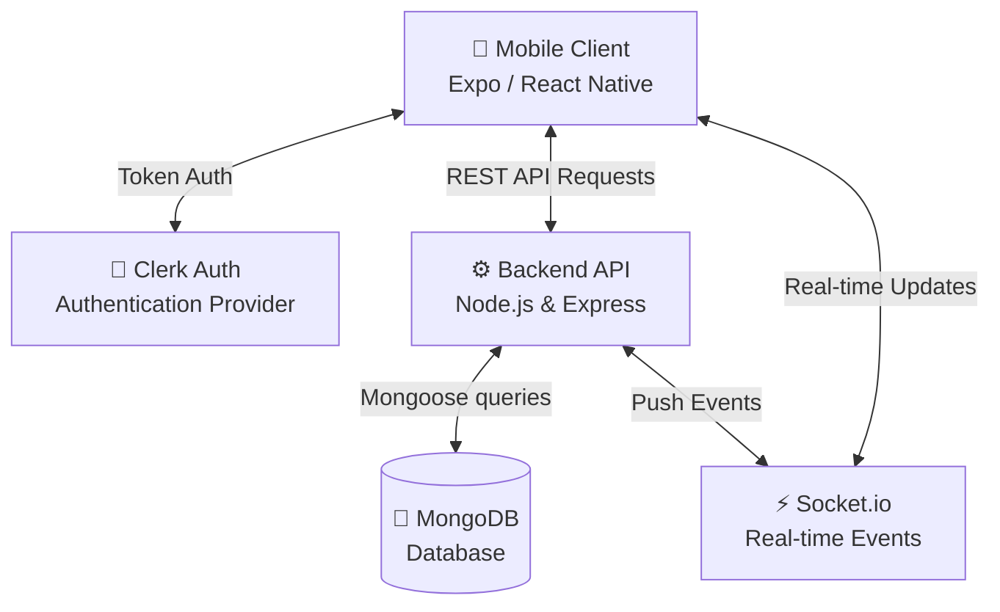

<div align="center">
  
  <h1>EventFlow</h1>
  <p>A comprehensive event scheduling, task management, and productivity tracking application.</p>
</div>

---

## 📖 About The App

EventFlow (also known as FocusFlow) is a full-stack mobile application designed to help users take control of their time. It combines calendar event scheduling, task prioritization, location-based tracking, and social connections into a single, seamless brutalist-styled interface. 

Whether you are managing daily routines, organizing community events, or collaborating with friends, EventFlow keeps you on track with real-time notifications and smart priority algorithms.

---

## 📸 Screenshots

<div align="center">
  
</div>

---

## 🛠 Tech Stack

### 📱 Frontend (Mobile App)


<br/>
**Libraries:** Clerk Auth (`@clerk/expo`), Zustand, Axios, Socket.io-client, React Native Maps, Custom Brutalist UI

### ⚙️ Backend (REST API)


<br/>
**Features:** JWT Auth, bcrypt, Multer (Uploads), Socket.io (Real-time), Express Rate Limit

---

## 🏗 Workflow Structure

### 🏛 System Architecture



The project is organized into a clean mono-repo structure containing both the frontend and backend applications, designed for independent scaling and development.

### 📱 Frontend Workflow
1. **Entry Point & Layouts:** The app uses Expo Router. The root `_layout.tsx` initializes the `ClerkProvider` and themes.
2. **Authentication Flow:** Unauthenticated users are directed to `(auth)/welcome.tsx`, followed by `login.tsx` or `register.tsx` managed securely by Clerk.
3. **Main Dashboard:** Once authenticated, users enter the `(tabs)` layout featuring:
   * **Home (`index.tsx`):** A summary dashboard of upcoming tasks and priority recommendations.
   * **Calendar (`calendar.tsx`):** A detailed view for event scheduling and time blocking.
   * **Statistics (`statistics.tsx`):** Productivity analytics and charts.
   * **Profile (`profile.tsx`):** User settings and friend connections.
4. **Features & Services:**
   * **State:** Global state (events, auth, theme) is managed via Zustand stores (`useEventStore`, `useAuthStore`).
   * **Hardware Integrations:** Custom hooks handle camera (`useCamera`), location (`useLocation`), and notifications (`useNotifications`).

### ⚙️ Backend Workflow
1. **Entry Point:** The server starts at `server.js` (or `app.js`), initializing Express, connecting to MongoDB, and setting up Socket.io.
2. **Routing:** Incoming API requests hit the `routes/` directory (e.g., `event.routes.js`, `taskRoutes.js`, `user.routes.js`).
3. **Controllers:** Routes delegate logic to `controllers/`, which handle request validation and response formatting.
4. **Services:** Complex business logic (like analytics processing in `analytics.service.js` or task prioritization in `priority.service.js`) is abstracted into the `services/` layer.
5. **Database Models:** Mongoose schemas in `models/` define the structure for Users, Events, Tasks, Reviews, and Friend Requests.
6. **Middleware:** Custom middleware handles authentication (`auth.middleware.js`), error handling (`error.middleware.js`), and file uploads (`upload.middleware.js`).

---

## 🚀 Getting Started

### Prerequisites
* Node.js installed
* Expo CLI installed (`npm install -g expo-cli`)
* MongoDB instance (local or Atlas)

### Running the Backend
```bash
cd backend
npm install
npm run dev
```

### Running the Frontend
```bash
cd frontend
npm install
npm run start
```