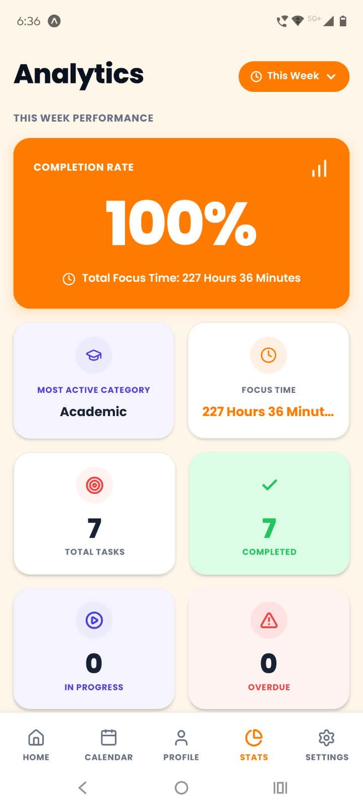
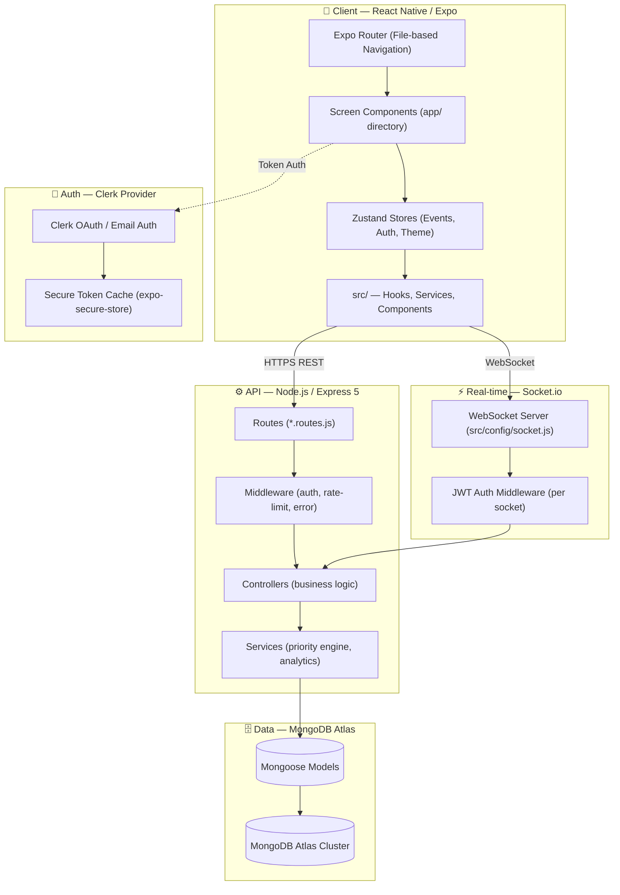
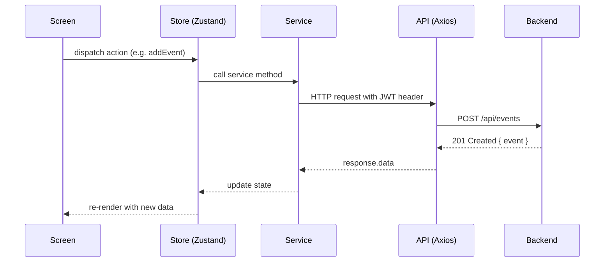
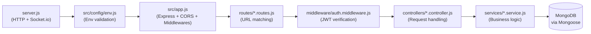

<div align="center">

  

  <h1>EventFlow</h1>

  <p>
    A full-stack, production-ready mobile productivity platform —<br/>
    smart event scheduling, AI priority ranking, real-time social features, and native alarm management.
  </p>

  <p>
    <a href="https://github.com/priyabratasahoo780/EventFlow/stargazers">
      
    </a>
    <a href="https://github.com/priyabratasahoo780/EventFlow/commits/main">
      
    </a>
    <a href="https://github.com/priyabratasahoo780/EventFlow/blob/main/LICENSE">
      
    </a>
    
    
    
    
  </p>

  <br/>

  | Welcome | Login | Home | Calendar |
  |:-:|:-:|:-:|:-:|
  |  |  |  |  |

  | Statistics | Settings | Community | Friends |
  |:-:|:-:|:-:|:-:|
  |  |  |  |  |

</div>

---

## Table of Contents

- [Overview](#overview)
- [Real-World Problems Solved](#-real-world-problems--edge-cases-solved)
- [Key Features](#key-features)
- [Complete Feature Overview](#-complete-feature-overview)
- [Recent Major Upgrades & Advanced UX](#-recent-major-upgrades--advanced-ux)
- [EventFlow vs. The Market](#️-eventflow-vs-the-market)
- [Tech Stack](#tech-stack)
- [Architecture](#architecture)
- [Project Structure](#project-structure)
- [Getting Started](#getting-started)
  - [Prerequisites](#prerequisites)
  - [Backend Setup](#backend-setup)
  - [Frontend Setup](#frontend-setup)
  - [Environment Variables](#environment-variables)
- [API Reference](#api-reference)
- [Folder Structure Deep Dive](#folder-structure-deep-dive)
- [Roadmap](#roadmap)
- [Contributing](#contributing)
- [License](#license)
- [Author](#author)

---

## Overview

**EventFlow** is a production-grade mobile application that goes far beyond a simple to-do list. It combines **smart event scheduling**, a **priority scoring engine**, **native Android alarm management**, **geofence-based location reminders**, and **real-time social features** into a single cohesive experience.

Built on a **React Native + Expo** frontend and a **Node.js + Express + MongoDB** backend, with a clean domain-driven folder architecture and zero TypeScript errors.

---

##  Real-World Problems & Edge Cases Solved

Building a reliable alarm and productivity app comes with complex edge cases, especially on modern mobile operating systems. Here is how EventFlow solves them:

1. **The "Silent Alarm" Problem (Android Doze Mode):**
   - **Problem:** Modern Android OS aggressively kills background apps and silences notifications to save battery (Doze mode). Standard React Native scheduling fails to wake the device.
   - **Solution:** We built a custom Kotlin `AlarmManagerModule` that uses `AlarmManager.setExactAndAllowWhileIdle`. Coupled with `PowerManager.WakeLock`, EventFlow literally turns on your phone screen from deep sleep, bypasses Doze, and rings audibly—even if the app was swiped away and killed weeks ago.

2. **The "Notification Clutter" Problem:**
   - **Problem:** Getting multiple standard notifications for both minor and major tasks leads to swipe-fatigue, causing users to ignore critical events.
   - **Solution:** Our multi-tier reminder system separates *gentle nudges* (standard push notifications) from *critical exact alarms* (full-screen modal with continuous ringing and haptics). You only get aggressive, screen-waking alarms for events that truly matter.

3. **The "Stale Data" Problem in Social Calendars:**
   - **Problem:** When sharing events with friends, polling the database for updates drains battery and often results in out-of-sync schedules.
   - **Solution:** We implemented a persistent **Socket.io** connection authenticated via JWT. When a friend updates an event you're invited to, your app receives the payload instantly and updates the global Zustand store in real-time without needing a manual refresh.

4. **The "Overwhelming To-Do List" Paralysis:**
   - **Problem:** Users abandon productivity apps when their overdue tasks pile up and everything looks equally important.
   - **Solution:** The **AI Priority Engine** constantly recalculates task importance based on deadline proximity and location. The Hero Focus Card isolates the *single most important thing* you should be doing right now, eliminating choice paralysis.

5. **The "Forgot to check-in/out" Location Problem:**
   - **Problem:** You need to be reminded of something specifically when you *leave* a location, not just when you arrive.
   - **Solution:** EventFlow combines bidirectional location triggers (arrive & leave) with AI priority ranking, native screen-waking alarms, and social buddy alerts in one unified platform. The background evaluator filters out high-speed highway drive-bys (3-minute dwell check) and alerts you precisely when your location context changes.

---

## Key Features

###  Event & Task Management
- Create events with **rich metadata**: category, priority, estimated duration, color, icon, linked contact, media (image/video)
- **Multi-reminder system** per event: `before`, `exact`, `daily`, `weekly`, `monthly`, `yearly`
- Smart status tracking: `pending → in_progress → completed → overdue`

###  AI Priority Engine & Dynamic Re-planning
- Dynamic priority scoring based on **deadline proximity**, **user-defined importance**, and **location distance**
- **AI Dynamic Rescheduling & Recovery**: Auto-detects schedule conflicts and missed tasks; analyzes free slots and proposes one-tap rebooking
- **Behavioral Learning & Duration Estimation**: Tracks per-category duration history, calculates completion rates, delay trends, and warns against chronic optimism
- Backend `/api/tasks/recommendation` endpoint for server-side priority suggestions

###  Travel-Time Awareness & Route Planning
- Real-time travel duration calculation based on user distance using urban speed heuristics (walking, cycling, driving)
- **Smart "Leave By" Departure Alerts**: Triggers notifications with safety buffers before you need to depart for location-based events
- Integrated map view with live route display and travel mode indicators

###  Native Alarm & Notification System (Offline-First)
- **100% Offline Capable**: Alarms fire precisely on time even if the app is completely closed (killed) or offline.
- **Dual-layer alert system**: `expo-notifications` for standard push/local banners + custom `AlarmManagerModule` (Kotlin) for **exact Android alarms**.
- **Deep Sleep Wake-Up**: Leverages Android `PowerManager.WakeLock` to turn the screen on and bypass Doze mode.
- Alarm modal with continuous looping sound, haptic feedback, and a snooze-like dismiss button.
- Graceful fallback on iOS and Expo Go.

###  Geofence Location Reminders
- Enable a **location trigger** per event: fire a reminder when you **arrive at** or **leave** the event location
- Powered by `expo-location` background task + custom geofencing engine
- Visual `LocationArrivalModal` with navigation shortcut

###  Social & Group Coordination
- Add friends by username/email with a **request → accept → connect** flow
- **Group Free-Time Slot Finder**: Cross-references friends' shared calendars to find overlapping free gaps for group events
- Share events with friends (visibility: `onlyMe`, `friends`, `selectedFriends`)
- Real-time friend event feed via **Socket.io**
- In-app DM messaging between friends

###  Analytics & Behavioral Insights
- Weekly productivity charts (gifted-charts)
- Category breakdown, completion trends, and on-time performance metrics
- Historical delay analysis and best/worst productivity hours
- Daily momentum progress bar on home screen

###  Premium UI
- Brutalist-inspired design system with custom `BrutalCard` and `BrutalButton` components
- Dark/Light theme via `useThemeStore`
- Smooth animations (Reanimated 4), haptic feedback on every interaction
- Hero card carousel with auto-scroll, category chips, status filter pills

---

##  Complete Feature Overview

> Every feature shipped in the current production build.

###  Event & Task Management

| Feature | Description | Status |
|:---|:---|:---:|
| Rich event creation | Category, priority, duration, color, icon, linked contact, media (image/video) | ✅ |
| Multi-reminder system | Per-event reminders: `before`, `exact`, `daily`, `weekly`, `monthly`, `yearly` | ✅ |
| Smart status lifecycle | `pending → in_progress → completed → overdue` with visual indicators | ✅ |
| Event detail screen | Full-page dynamic screen (`/event/[id]`) with edit & delete | ✅ |
| Add Event screen | Full-form screen with all fields, validation, and media upload | ✅ |
| Task Triage view | Bulk-manage overdue/pending tasks from a dedicated triage screen | ✅ |
| Calendar view | Monthly/weekly visual calendar with event dots and filters | ✅ |
| Category chips & filters | Filter events by category, status, or priority on the home screen | ✅ |
| Hero Focus Card carousel | Auto-scrolling top 3 AI-ranked events as full-bleed hero cards | ✅ |

---

###  AI Priority Engine & Smart Recovery

| Feature | Description | Status |
|:---|:---|:---:|
| Dynamic priority scoring | Weighs **deadline proximity**, **user-defined importance**, and **location distance** | ✅ |
| Server-side recommendation | `/api/tasks/recommendation` returns top-ranked task | ✅ |
| Client-side ranking | Instant re-rank on Zustand state changes without API call | ✅ |
| AI Dynamic Rescheduling | Computes free slot intervals and generates ranked alternative times for triage | ✅ |
| Missed Task Impact Analysis | Identifies friends and dependent items affected when a shared task is missed | ✅ |
| Behavioral Learning | Tracks per-category duration history, actual vs estimated drift, and delay patterns | ✅ |
| Duration Prediction & Warning | Proactive warning when scheduled duration is unrealistically optimistic | ✅ |
| Overdue auto-detection | Backend cron-style check; status flips to `overdue` automatically | ✅ |

---

###  Alarm & Notification System

| Feature | Description | Status |
|:---|:---|:---:|
| Local push notifications | `expo-notifications` banners with sound (all platforms, foreground + background) | ✅ |
| Native Android exact alarms | Custom `AlarmManagerModule` (Kotlin) — fires precisely on time even if app is killed | ✅ |
| Deep sleep wake-up | `PowerManager.WakeLock` bypasses Android Doze mode; screen turns on | ✅ |
| Alarm modal UI | Looping alarm sound, haptics, animated dismiss button | ✅ |
| Multi-reminder support | Schedule multiple alarm times per single event | ✅ |
| "Leave By" Departure Alerts | Proactive alerts calculated from live distance and transit speeds | ✅ |
| Expo Go graceful fallback | Fallback to standard notifications when native module unavailable | ✅ |

---

###  Geofence & Location Intelligence

| Feature | Description | Status |
|:---|:---|:---:|
| Location trigger per event | Enable arrive-at / leave-location reminders | ✅ |
| Background geofencing | `expo-location` background task + custom geofencing engine | ✅ |
| Location Arrival Modal | In-app overlay with map shortcut when you enter the event zone | ✅ |
| Travel Time & Speed Model | Realistic travel calculation across walking, cycling, and driving | ✅ |
| Interactive Map & Route Display | Full-screen `/map` view with event markers, destination selector, and live route lines | ✅ |
| Location selector | Pick event location from map directly inside the Add Event flow | ✅ |

---

###  Social & Group Coordination

| Feature | Description | Status |
|:---|:---|:---:|
| Friend discovery | Search by username or email | ✅ |
| Request → Accept → Connect | Full friend request lifecycle with reject support | ✅ |
| Group Free-Time Scheduling | Finds overlapping free calendar slots among selected friends | ✅ |
| Event sharing | Share events with visibility: `onlyMe`, `friends`, `selectedFriends` | ✅ |
| Real-time friend event feed | Friends' shared events streamed via Socket.io | ✅ |
| In-app DM messaging | Direct messages between connected friends | ✅ |
| Remove friend | Unfriend with confirmation | ✅ |

---

###  Community

| Feature | Description | Status |
|:---|:---|:---:|
| Public reviews feed | Users post reviews visible to the whole community | ✅ |
| Like / toggle reactions | Tap to like or unlike any community review | ✅ |
| Review creation | Rich text review submission from the Community screen | ✅ |

---

###  Analytics & Behavioral Insights

| Feature | Description | Status |
|:---|:---|:---:|
| Weekly productivity chart | Bar chart of events completed per day (gifted-charts) | ✅ |
| Category breakdown | Pie/segment breakdown by event category | ✅ |
| Behavioral category insights | Average delay minutes, on-time percentage, and optimal work hours | ✅ |
| Completion trend | Historical trend of task completion rate | ✅ |
| Daily momentum bar | Home screen progress bar showing today's completion % | ✅ |
| Dashboard API | `/api/analytics/dashboard`, `/weekly`, `/categories` endpoints | ✅ |

---

###  UI & Experience

| Feature | Description | Status |
|:---|:---|:---:|
| Animated Splash Screen | Custom `SplashScreenView` with branded animation sequence | ✅ |
| Dark / Light theme | System-aware + manual toggle via `useThemeStore` | ✅ |
| Haptic feedback | Every tap triggers haptic via `expo-haptics` | ✅ |
| Smooth animations | Reanimated 4 — shared values, layout transitions, spring physics | ✅ |
| BrutalCard / BrutalButton | Custom design-system primitives used across all screens | ✅ |
| Responsive layout | Scales cleanly across phone sizes (portrait only) | ✅ |
| Media picker | Image & video picker with preview (Expo ImagePicker) | ✅ |
| Offline-first alarms | Alarms work 100% without internet | ✅ |
| Lottie Splash Animation Sequence | Cinematic multi-stage vector animations (portal, particles, kinetic loader) with procedural fallback | ✅ |
| High-Urgency Radar Alarm Screen | Concentric expanding pulse rings, oscillating bell with spring physics, live digital clock, and swipe dismiss | ✅ |
| AI Productivity Insights UI | Generative category velocity, focus hours, and procrastination analysis with glassmorphic cards | ✅ |
| Modernized Geofence Selector | Full-width address bar, dual GPS & Map action buttons, segmented distance selector, and live radar status pill | ✅ |
| Friends & Social Hub Overhaul | Live friend counter, two-tier card layout with status indicators, and one-tap cheer/chat actions | ✅ |
| 3D Glossy Brand Identity | Unified 3D orange emblem across app icon, native splash (#070714), auth screens, and settings | ✅ |

---

##  Recent Major Upgrades & Advanced UX

> A comprehensive overview of recent production-grade design and architecture enhancements delivered to EventFlow.

### 🎬 1. Cinematic Lottie Multi-Stage Splash Screen
- **Portal & Particle Physics**: Built with `lottie-react-native`, transitioning from a glowing cosmic portal (`eventflow-portal.json`) through dynamic ambient particles (`eventflow-particles.json`) to a kinetic branding sequence.
- **Procedural Vector Engine**: Includes `frontend/assets/lottie/generate-lotties.js` for standalone mathematical generation of 60 FPS vector Lottie JSONs.
- **Seamless App Handshake**: Synchronized with `expo-splash-screen` to eliminate blank flashes and deliver an instant 60 FPS entry into EventFlow.

### 🧠 2. AI Behavioral Insights & Productivity Intelligence
- **Real-Time Insight Engine**: Integrated into the Statistics screen (`app/(tabs)/statistics.tsx`) via `AiInsightSection.tsx` and `AiInsightCard.tsx`.
- **4-Vector Analysis**:
  - ⚡ **Peak Focus Hours**: Identifies when task completion efficiency is at its highest based on historical completion logs.
  - 📈 **Category Velocity**: Analyzes momentum trends across work, personal, fitness, and study.
  - ⏳ **Procrastination Detection**: Flags recurring delay patterns with proactive warnings.
  - 💡 **Actionable Productivity Tips**: Recommends personalized scheduling nudges.
- **Glassmorphic Presentation**: Sleek cards with glowing linear gradients, squircle icons, and smooth entrance transitions.

### 🚨 3. High-Urgency Radar Alarm Screen & Native Lockscreen Integration
- **Concentric Radar Waveform**: Triple expanding pulse rings with Reanimated 4 looping scale and opacity physics.
- **Oscillating Bell Animation**: Physics-based bell chime oscillation with high-tactile haptic feedback (`Haptics.notificationAsync`).
- **Live Digital Clock**: Real-time `HH:mm:ss` counter with glowing date subtitle.
- **Universal Mount**: Mounted globally in root layout (`_layout.tsx`) so exact alarms trigger instant full-screen takeover from any view, matched with Kotlin Android lockscreen activity (`AlarmActivity.kt`).
- **One-Tap Snooze & Tactile Slide Dismiss**: Prevents accidental dismissal while ensuring critical deadlines cannot be missed.

### 📍 4. Modernized Location & Arrival Geofence Intelligence
- **Adaptive Theme Architecture**: Built for both Dark Mode (`#1A182E`) and Light Mode (`#F9F8FD`) with subtle elevation.
- **Uncrowded Full-Width Search**: Dedicated `48dp` address input field preventing text truncation, complete with instant clear (`X`) trigger.
- **Dual Thumb-Friendly Actions**: Side-by-side Indigo GPS button (`Use Current GPS`) and Orange Map button (`Pick on Map`).
- **Segmented Distance Selector**: High-contrast, equal-width pills (`100m`, `200m`, `300m`, `500m`, `1km`) with dynamic trigger badge.
- **Emerald Radar Confirmation Pill**: High-legibility status confirmation pill with circular checkmark badge.

### 🤝 5. Friends & Social Hub Redesign
- **Live Connected Counter**: Real-time connected friend badge with live socket presence.
- **Two-Tier Segmented Cards**: Clean layout featuring personalized initials, status indicators, and dedicated quick-action triggers (DM Chat, Cheer/Nudge modal, Event invite).
- **Interactive Cheer Modal**: Instant social encouragement with celebratory animations and haptics.

### 🎨 6. Standardized 3D Glossy Brand Identity
- **Unified Emblem**: Standardized custom 3D glossy orange emblem (`icon_squared.png`) across all application surfaces.
- **Android Manifest & Drawables**: Full set of high-res density drawables (`mipmap-mdpi` through `mipmap-xxxhdpi`).
- **Dark Deep Space Native Splash**: Native Android and iOS splash background set to `#070714` for cohesive OLED bootup.
- **Auth & Settings Integration**: Standardized across Welcome, Login, Register, Forgot Password, and Settings views.

### ☁️ 7. Hybrid Device + Cloudinary Media Storage
- **Privacy-First On-Device Media (`Only Me`)**: Private task photos, videos, and local avatars persist strictly inside the app's sandboxed device storage (`services/localMediaService.ts`) — consuming **0 KB** of cloud storage.
- **Auto-Optimized Cloud Sharing (`Friends` / `Selected Friends`)**: When a task is shared with friends (or Admin publishes a Festival Banner), media automatically uploads to **Cloudinary** with `quality: auto:good` and `fetch_format: auto` optimization, with automatic cloud cleanup when tasks, banners, or accounts are deleted.

### 🛡️ 8. Biometric Admin Command Center & Strict Task Privacy
- **Multi-Layer Vault Lock**: Supports Biometric (Fingerprint / Face ID), Device Pattern/PIN fallback, and Admin Password (`services/biometricAuth.ts`).
- **Scheduled Festival Greeting Cards**: Publish seasonal banners with interactive Date & Time window pickers (`startDate` → `endDate`), auto-showing on users' home screens during the window and auto-hiding upon expiration.
- **Strict Privacy Block**: Admin endpoints enforce `403 Forbidden` isolation on `/api/admin/tasks` — Admins can moderate community reviews and manage users but can **never** view or modify user tasks.

### 💬 9. Full-Duplex Socket.IO Presence & Live Friend Chat
- **Resilient Transport**: Dual `websocket` + `polling` transport with infinite auto-reconnect, token refresh handling, and foreground state sync.
- **Live Presence & Typing**: Real-time online/offline indicators (`check_online`, `user_status`), live `typing...` indicators, persistent chat history (`/api/friends/messages/:friendId`), focus cheers, and instant friend request notifications.

### 📱 10. Full Cross-Device Responsiveness & Production Hardening
- **Adaptive Layout Engine**: Dynamic scaling (`constants/responsive.ts`, `ResponsiveContainer.tsx`) supporting compact phones, standard phones, tablets, foldables, and web viewports, plus safe-area bottom padding for Android 3-button navigation bars.
- **80-Task Active Cap**: Caps visible screen tasks at 80 with oldest-task archival confirmation while preserving analytics history forever.

---

##  EventFlow vs. The Market

> How EventFlow stacks up against the most popular event & calendar apps available today.

| Feature | **EventFlow** | Google Calendar | Apple Calendar | Todoist | TickTick | Any.do |
|:---|:---:|:---:|:---:|:---:|:---:|:---:|
| **Smart AI Priority Ranking** | ✅ Built-in | ❌ | ❌ | ✅ Basic | ✅ Basic | ❌ |
| **Native Exact Alarms (bypasses Doze)** | ✅ Custom Kotlin | ❌ | ❌ | ❌ | ❌ | ❌ |
| **Deep-sleep Screen Wake-up** | ✅ WakeLock | ❌ | ❌ | ❌ | ❌ | ❌ |
| **Multi-type reminders per event** | ✅ 6 types | ✅ 3 types | ✅ 2 types | ✅ (premium) | ✅ (premium) | ✅ (premium) |
| **Geofence Location Reminders** | ✅ Arrive & Leave | ✅ Arrive only | ❌ | ❌ | ✅ (premium) | ✅ (premium) |
| **Real-time Social Event Feed** | ✅ Socket.io | ❌ | ❌ | ❌ | ❌ | ❌ |
| **In-app Friend Messaging (DM)** | ✅ | ❌ | ❌ | ❌ | ❌ | ❌ |
| **Friend Request System** | ✅ | ❌ | ❌ | ❌ | ❌ | ❌ |
| **Community Reviews Feed** | ✅ | ❌ | ❌ | ❌ | ❌ | ❌ |
| **Event Media (Image / Video)** | ✅ | ❌ | ❌ | ✅ image only | ✅ image only | ❌ |
| **Weekly Analytics Dashboard** | ✅ Custom charts | ✅ Basic | ❌ | ✅ (premium) | ✅ (premium) | ❌ |
| **Task Triage Screen** | ✅ | ❌ | ❌ | ✅ | ✅ | ✅ |
| **Hero Focus Card (top event)** | ✅ | ❌ | ❌ | ✅ | ❌ | ✅ (premium) |
| **Full-screen Map with Event Pins** | ✅ | ✅ | ✅ | ❌ | ❌ | ❌ |
| **Open Source & Self-hostable** | ✅ MIT | ❌ | ❌ | ❌ | ❌ | ❌ |
| **Zero Subscription / Free Forever** | ✅ | ✅ (basic) | ✅ | ❌ (freemium) | ❌ (freemium) | ❌ (freemium) |
| **Offline-first Alarm Engine** | ✅ | ⚠️ partial | ⚠️ partial | ⚠️ partial | ⚠️ partial | ⚠️ partial |


###  What Differentiates EventFlow

> EventFlow is designed as a unified context-aware productivity system that combines AI task prioritization, physical location, travel-aware scheduling, native alarm infrastructure, social coordination, and real-time event updates in a single mobile experience. Rather than claiming any single feature is completely unique, EventFlow focuses on combining these capabilities seamlessly without paywalls.

| Core Focus | Why It Matters |
|:---|:---|
|  **Native Android WakeLock Alarm** | Most apps rely on OS notifications which can be silenced by battery optimization. EventFlow wakes the screen and plays sound even when the app is force-killed — like a real alarm clock. |
|  **Social Event Sharing with Real-time Feed** | Built-in friend-based event feed with Socket.io live updates. Share your events with specific friends and coordinate without third-party messaging tools. |
|  **In-app DM between friends** | Combined in a single event app — no need to switch to WhatsApp to coordinate plans. |
|  **Context-Aware Multi-Factor Priority Engine** | Priority combines deadline proximity, user-defined urgency, duration risk, and physical distance to determine what needs action next. |
|  **Bidirectional Geofencing & Buddy Proximity** | Combines arrive/leave geofences with speed/dwell-time anti-spam filters, native alarms, and automated buddy alerts when friends arrive near shared task venues. |
|  **Public Community Reviews** | A social review feed inside a productivity app — sharing experiences and productivity tips. |
|  **100% Free, Open Source, Self-hostable** | Many commercial apps charge for location reminders and analytics. EventFlow is MIT-licensed with no paywalls. |

---

## Tech Stack

### Frontend

| Technology | Version | Role |
|:---|:---:|:---|
|  | 0.88 | Core mobile framework |
|  | 58 | Build, OTA, native modules |
|  | 6.x | Strict type safety |
|  | v4 | File-based navigation |
|  | 5.x | Lightweight global state |
|  | 4.x | Authentication & JWT |
|  | 4.x | Real-time events & chat |
| Axios | 1.x | HTTP client |
| React Native Maps | 1.27 | Maps + geofence display |
| Reanimated | 4.x | Smooth animations |
| Lottie React Native | 7.x | Cinematic vector splash & physics animations |

**Key Expo modules:** `expo-notifications`, `expo-location`, `expo-task-manager`, `expo-video`, `expo-audio`, `expo-asset`, `expo-haptics`, `expo-image-picker`, `expo-local-authentication`, `expo-secure-store`, `expo-file-system`, `expo-linear-gradient`

### Backend

| Technology | Version | Role |
|:---|:---:|:---|
|  | 20+ | Runtime |
|  | 5.x | REST framework |
|  | Atlas | Primary database |
|  | 9.x | ODM / schema validation |
|  | 4.x | WebSocket + polling server |
|  | v2 | Cloud image/video CDN + auto-compression |
| JWT | 9.x | Stateless auth tokens |
| bcryptjs | 3.x | Password hashing |
| Multer | 2.x | File upload + magic-byte validation |
| expo-server-sdk | 7.x | Expo push notifications |
| express-rate-limit | 8.x | API rate limiting |

---

## Architecture

### System Overview



### Frontend Request Flow



### Backend Request Pipeline



---

## Project Structure

```
EventFlow/                              # Mono-repo root
├── render.yaml                         # Render production deployment blueprint
├── backend/                            # Node.js + Express 5 API
│   ├── server.js                       # Entry point (HTTP + Socket.io + graceful shutdown)
│   └── src/
│       ├── config/
│       │   ├── cloudinary.js           # Cloudinary CDN integration & auto-compression
│       │   ├── db.js                   # MongoDB connection
│       │   ├── env.js                  # Env validation (fail-fast)
│       │   ├── seedAdmin.js            # Auto-seeds Admin Portal account
│       │   └── socket.js               # Socket.io setup (presence, typing, JWT rooms)
│       ├── controllers/
│       │   ├── admin.controller.js     # Overview, reviews, users, festival cards, privacy lock
│       │   ├── analytics.controller.js
│       │   ├── auth.controller.js
│       │   ├── event.controller.js
│       │   ├── friend.controller.js
│       │   ├── review.controller.js
│       │   ├── task.controller.js
│       │   ├── upload.controller.js    # Cloudinary upload + safe local fallback
│       │   └── user.controller.js
│       ├── middleware/
│       │   ├── admin.middleware.js     # Admin role verification
│       │   ├── auth.middleware.js      # JWT verification
│       │   ├── error.middleware.js     # Global error handler
│       │   ├── rateLimiter.js          # API, auth, OTP & search rate limits
│       │   ├── upload.middleware.js    # Multer + magic-byte malware checks
│       │   └── userOnly.middleware.js  # Prevents Admin access to user task flows
│       ├── models/
│       │   ├── Event.js
│       │   ├── FestivalBanner.js
│       │   ├── FriendRequest.js
│       │   ├── Message.js
│       │   ├── Review.js
│       │   └── User.js
│       ├── routes/
│       │   ├── admin.routes.js
│       │   ├── analytics.routes.js
│       │   ├── auth.routes.js
│       │   ├── event.routes.js
│       │   ├── festival.routes.js
│       │   ├── friend.routes.js
│       │   ├── review.routes.js
│       │   ├── task.routes.js
│       │   ├── upload.routes.js
│       │   └── user.routes.js
│       ├── services/
│       │   ├── analytics.service.js
│       │   ├── email.service.js
│       │   └── priority.service.js     # Dynamic priority scoring engine
│       └── utils/
│           └── logger.js               # Structured logger (ISO timestamps)
│
└── frontend/                           # React Native + Expo 58 app
    ├── app/                            # Expo Router file-based routing
    │   ├── (auth)/                     # welcome, login, register, forgot-password
    │   ├── (tabs)/                     # home, calendar, stats, profile, settings
    │   ├── admin/index.tsx             # Biometric-protected Admin Command Center
    │   ├── event/[id].tsx              # Dynamic event detail & zoom preview screen
    │   ├── add-event.tsx               # Create/edit task with hybrid media & visibility
    │   ├── triage.tsx                  # AI Task triage & smart rescheduling
    │   ├── friends/                    # connect, list (live chat), requests, groupSchedule
    │   ├── community/reviews.tsx       # Community reviews feed
    │   ├── map.tsx                     # Full-screen interactive map & route planning
    │   └── _layout.tsx                 # Root layout (ClerkProvider, fonts, themes, alarms)
    │
    ├── components/                     # Core UI Components
    │   ├── AiInsightCard.tsx
    │   ├── AiInsightSection.tsx
    │   ├── AlarmModal.tsx
    │   ├── BrutalButton.tsx
    │   ├── BrutalCard.tsx
    │   ├── BuddyAlertModal.tsx
    │   ├── DynamicIslandTaskBar.tsx
    │   ├── EventCard.tsx
    │   ├── GeofenceReminderSection.tsx
    │   ├── LocationSelector.tsx
    │   ├── MediaPicker.tsx             # Hybrid device/cloud media picker
    │   ├── ResponsiveContainer.tsx     # Cross-device tablet/web max-width wrapper
    │   └── SplashScreenView.tsx
    ├── constants/
    │   ├── Colors.ts
    │   ├── responsive.ts               # Breakpoints, rs/ms/hs scaling, useResponsive hook
    │   └── theme.ts
    ├── services/                       # API, socket, local/cloud media & native engines
    │   ├── api.ts                      # Axios client + resolveMediaUrl helper
    │   ├── biometricAuth.ts            # Biometric / Device PIN / Admin lock config
    │   ├── localMediaService.ts        # On-device persistence + Cloudinary uploader
    │   ├── socketService.ts            # Resilient WebSocket + Polling client
    │   ├── notificationService.ts      # Exact alarms + leave-by departure alerts
    │   ├── geofencingService.ts        # Background Arrive/Leave geofencing
    │   └── priorityService.ts          # Multi-factor priority score engine
    ├── store/                          # Zustand stores (useEventStore, useAuthStore, useThemeStore)
    ├── android_backup/                 # Custom Native Android Modules (Kotlin Alarms)
    ├── plugins/withAlarmManager.js     # Expo config plugin injecting native alarms
    ├── eas.json                        # EAS Build profiles (preview, apk, production-apk, production)
    └── app.json                        # Expo app config (permissions, plugins, icons)
```

---

## Getting Started

### Prerequisites

| Tool | Version | Notes |
|:---|:---|:---|
| Node.js | **≥ 20.x** | [nodejs.org](https://nodejs.org) |
| npm | **≥ 9.x** | Bundled with Node.js |
| MongoDB | Local or Atlas | [mongodb.com/cloud/atlas](https://www.mongodb.com/cloud/atlas) |
| Expo Go App | Latest | Scan QR for quick testing (Android/iOS) |
| Android Studio | Optional | For full native build / emulator |

> **Important:** The native `AlarmManagerModule` (exact Android alarms) only works in a custom development build or APK, **not** in Expo Go. All other features run in Expo Go.

---

### Clone the Repository

```bash
git clone https://github.com/priyabratasahoo780/EventFlow.git
cd EventFlow
```

---

### Backend Setup

```bash
cd backend

# Install dependencies
npm install

# Copy and configure environment variables
cp .env.example .env
# → Edit .env with your values (see Environment Variables section below)

# Start development server with hot-reload
npm run dev
# → Server starts at http://localhost:5000
```

**Available scripts:**

| Script | Description |
|:---|:---|
| `npm run dev` | Start with nodemon (hot-reload) |
| `npm start` | Start in production mode |

---

### Frontend Setup

```bash
cd frontend

# Install dependencies
npm install

# Start the Expo development server (with cache clear)
npx expo start -c

# Platform-specific launchers:
npm run android   # Android emulator / physical device
npm run ios       # iOS simulator (macOS only)
npm run web       # Web browser (limited native features)

# Production build (EAS):
npm run build:apk       # Internal preview APK via EAS Build
npm run build:apk:prod  # Production APK via EAS Build
```

**Available scripts:**

| Script | Description |
|:---|:---|
| `npm start` | Start Expo dev server |
| `npm run android` | Run on Android |
| `npm run ios` | Run on iOS |
| `npm run web` | Run in browser |
| `npm run build:apk` | EAS preview build (Android APK) |
| `npm run build:apk:prod` | EAS production build (Android APK) |

> Scan the QR code shown in the terminal with the **Expo Go** app to test instantly on a physical device.

---

### Environment Variables

#### Backend — `backend/.env`

```env
# Server
PORT=5000
NODE_ENV=development

# Database
MONGO_URI=mongodb+srv://<user>:<password>@cluster.mongodb.net/eventflow

# Authentication
JWT_SECRET=your_super_secret_jwt_key_min_32_chars
CLERK_SECRET_KEY=sk_test_your_clerk_secret_key

# Gmail SMTP for OTP & Password Reset (optional)
EMAIL_USER=your_email@gmail.com
EMAIL_PASS=your_16_char_app_password
EMAIL_FROM="EventFlow Security <your_email@gmail.com>"

# Admin Portal Account (auto-seeded on startup)
ADMIN_EMAIL=admin@eventflow.app
ADMIN_PASSWORD=your_strong_admin_password

# Cloudinary Cloud Storage (Shared media & Festival banners)
CLOUDINARY_CLOUD_NAME=your_cloud_name
CLOUDINARY_API_KEY=your_api_key
CLOUDINARY_API_SECRET=your_api_secret

# Expo Push Notifications (optional)
EXPO_ACCESS_TOKEN=your_expo_access_token
```

> **Required fields** (server will throw at startup if missing): `MONGO_URI`, `JWT_SECRET`

#### Frontend — `frontend/.env` (if needed)

```env
EXPO_PUBLIC_API_URL=https://eventflow-ks7m.onrender.com/api
EXPO_PUBLIC_CLERK_PUBLISHABLE_KEY=pk_test_your_clerk_key
```

> Variables prefixed with `EXPO_PUBLIC_` are safe to embed in the client bundle.

---

## API Reference

> All protected endpoints require: `Authorization: Bearer <jwt_token>`

### Auth — `/api/auth`

| Method | Endpoint | Protected | Description |
|:---:|:---|:---:|:---|
| `POST` | `/api/auth/register` | ✗ | Register a new user (email + password) |
| `POST` | `/api/auth/login` | ✗ | Login and receive JWT |
| `POST` | `/api/auth/google` | ✗ | Login with Google OAuth |
| `POST` | `/api/auth/sync` | ✗ | Sync Clerk user with MongoDB |
| `POST` | `/api/auth/forgot-password` | ✗ | Send password reset email |
| `GET` | `/api/auth/profile` | ✓ | Get authenticated user's profile |

### Users — `/api/users`

| Method | Endpoint | Protected | Description |
|:---:|:---|:---:|:---|
| `GET` | `/api/users/profile` | ✓ | Get current user profile |
| `PUT` | `/api/users/profile` | ✓ | Update user profile |
| `POST` | `/api/users/push-token` | ✓ | Register Expo push notification token |

### Events — `/api/events`

| Method | Endpoint | Protected | Description |
|:---:|:---|:---:|:---|
| `POST` | `/api/events` | ✓ | Create a new event |
| `GET` | `/api/events` | ✓ | Get all events for current user |
| `GET` | `/api/events/friends` | ✓ | Get shared events from friends |

### Tasks — `/api/tasks`

| Method | Endpoint | Protected | Description |
|:---:|:---|:---:|:---|
| `GET` | `/api/tasks` | ✓ | Get all tasks (sorted by priority) |
| `GET` | `/api/tasks/recommendation` | ✓ | Get top AI-ranked task recommendation |
| `POST` | `/api/tasks` | ✓ | Create a new task |
| `GET` | `/api/tasks/:id` | ✓ | Get task by ID |
| `PUT` | `/api/tasks/:id` | ✓ | Update task details |
| `PATCH` | `/api/tasks/:id/status` | ✓ | Update task status only |
| `DELETE` | `/api/tasks/:id` | ✓ | Delete a task |

### Friends — `/api/friends`

| Method | Endpoint | Protected | Description |
|:---:|:---|:---:|:---|
| `POST` | `/api/friends/search` | ✓ | Search user by name or email |
| `POST` | `/api/friends/request` | ✓ | Send a friend request |
| `GET` | `/api/friends/requests` | ✓ | Get incoming friend requests |
| `POST` | `/api/friends/accept` | ✓ | Accept a friend request |
| `POST` | `/api/friends/reject` | ✓ | Reject a friend request |
| `GET` | `/api/friends` | ✓ | Get full friends list |
| `GET` | `/api/friends/events` | ✓ | Get friends' shared events |
| `POST` | `/api/friends/message` | ✓ | Send a DM to a friend |
| `GET` | `/api/friends/messages/:friendId` | ✓ | Get message history with a friend |
| `DELETE` | `/api/friends/remove` | ✓ | Remove a friend |

### Reviews — `/api/reviews`

| Method | Endpoint | Protected | Description |
|:---:|:---|:---:|:---|
| `POST` | `/api/reviews` | ✓ | Create a community review |
| `GET` | `/api/reviews` | ✓ | Get all community reviews |
| `POST` | `/api/reviews/:id/like` | ✓ | Toggle like on a review |

### Analytics — `/api/analytics`

| Method | Endpoint | Protected | Description |
|:---:|:---|:---:|:---|
| `GET` | `/api/analytics/dashboard` | ✓ | Dashboard summary statistics |
| `GET` | `/api/analytics/weekly` | ✓ | Weekly productivity chart data |
| `GET` | `/api/analytics/categories` | ✓ | Task breakdown by category |

### Uploads — `/api/upload`

| Method | Endpoint | Protected | Description |
|:---:|:---|:---:|:---|
| `POST` | `/api/upload/image` | ✓ | Upload image (10MB max) to Cloudinary CDN (with local fallback) |
| `POST` | `/api/upload/video` | ✓ | Upload video (50MB max) to Cloudinary CDN (with local fallback) |
| `DELETE` | `/api/upload/:id` | ✓ | Delete an uploaded image/video (supports `?target=` for Cloudinary IDs) |

### Admin & Festivals — `/api/admin` & `/api/festival`

| Method | Endpoint | Protected | Description |
|:---:|:---|:---:|:---|
| `GET` | `/api/festival/active` | ✓ | Get currently active Festival Greeting Card within scheduled window |
| `GET` | `/api/admin/overview` | Admin | Dashboard stats & sentiment overview |
| `GET` | `/api/admin/reviews` | Admin | Moderate community reviews |
| `DELETE` | `/api/admin/reviews/:id` | Admin | Delete a community review |
| `GET` | `/api/admin/users` | Admin | List/search registered users |
| `PATCH` | `/api/admin/users/:id/ban` | Admin | Suspend or restore a user |
| `DELETE` | `/api/admin/users/:id` | Admin | Delete user and cascade-clean cloud/local assets |
| `GET/POST/PATCH/DELETE` | `/api/admin/festival` | Admin | Manage scheduled Festival Greeting Cards |
| `GET` | `/api/admin/tasks` | 403 | Strictly blocked (`403`) to protect user task privacy |

---

## Folder Structure Deep Dive

### Path Aliases (Frontend)

The frontend uses Babel `module-resolver` so imports are clean and refactor-safe:

```typescript
//  Before (brittle relative paths)
import { useEventStore } from '../../../../store/useEventStore';
import BrutalButton from '../../components/BrutalButton';

//  After (clean path aliases)
import { useEventStore } from '@/store';
import { BrutalButton } from '@/components/ui';
```

| Alias | Resolves to |
|:---|:---|
| `@/*` | `./src/*` |
| `@/components` | `./src/components` |
| `@/store` | `./src/store` |
| `@/hooks` | `./src/hooks` |
| `@/services` | `./src/services` |
| `@/types` | `./src/types` |
| `@/constants` | `./src/constants` |
| `@/lib` | `./src/lib` |

### Barrel Exports

Every `src/` subdirectory has an `index.ts` barrel for clean tree-shakable imports:

```typescript
// Single import for all UI primitives
import { BrutalButton, BrutalCard, LoadingScreen, EmptyState } from '@/components/ui';

// Single import for all stores
import { useEventStore, useAuthStore, useThemeStore } from '@/store';
```

### Notification Architecture

```
Notification triggered
  ├── expo-notifications → Banner + sound (all platforms, foreground)
  └── AlarmManagerModule (Kotlin) → Exact alarm (Android, even background/killed)
        └── AlarmModal fires on exact time match via 1-second foreground poll
```

---

## Roadmap

- [x] Multi-reminder system (before/exact/daily/weekly/monthly/yearly)
- [x] Native Android AlarmManager integration
- [x] Geofence location reminders (arrive/leave)
- [x] Real-time friend events via Socket.io
- [x] AI priority scoring engine
- [x] Production-ready folder structure with path aliases
- [x] Push notifications via Expo server SDK
- [x] Group events and collaborative task lists
- [x] Offline mode with AsyncStorage-first sync
- [x] EAS Update (OTA updates in production)
- [x] End-to-end encrypted DMs
- [x] Widget support (Android/iOS)
- [x] Cinematic Lottie multi-stage animated splash sequence
- [x] High-urgency radar pulse alarm modal & native lockscreen
- [x] AI behavioral insights & productivity intelligence engine
- [x] Modernized dual-action geofence & radius selector

---

## Contributing

Contributions are what make open source amazing. Any contribution you make is **greatly appreciated**.

1. **Fork** the repository
2. Create your feature branch: `git checkout -b feat/amazing-feature`
3. Commit your changes: `git commit -m 'feat: add amazing feature'`
4. Push to the branch: `git push origin feat/amazing-feature`
5. Open a **Pull Request**

**Commit message format** (Conventional Commits):

| Prefix | When to use |
|:---|:---|
| `feat:` | New feature |
| `fix:` | Bug fix |
| `refactor:` | Code restructure (no feature change) |
| `docs:` | Documentation only |
| `chore:` | Build/tooling changes |

---

## License

Distributed under the **MIT License**. See [`LICENSE`](LICENSE) for more information.

---

## Author

<div align="center">

**Priyabrata Sahoo**

[](https://github.com/priyabratasahoo780)
[](https://github.com/priyabratasahoo780/EventFlow/issues)

---

<sub>Built with ❤️ passion and precision.</sub>


<br/><br/>
<sub>© 2026 EventFlow — All rights reserved.</sub>

</div>