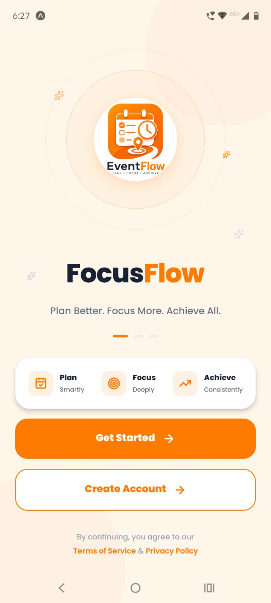

<div align="center">
  
  <h1>EventFlow</h1>
  <p>A comprehensive event scheduling, task management, and productivity tracking application.</p>
</div>

---

## 📖 About The App

EventFlow (also known as FocusFlow) is a full-stack mobile application designed to help users take control of their time. It combines calendar event scheduling, task prioritization, location-based tracking, and social connections into a single, seamless brutalist-styled interface. 

Whether you are managing daily routines, organizing community events, or collaborating with friends, EventFlow keeps you on track with real-time notifications and smart priority algorithms.

---

## 🎨 App Preview

<div align="center">
  
</div>

---


## 🛠 Tech Stack

### 📱 Frontend (Mobile App)


<br/>
**Libraries:** Clerk Auth (`@clerk/expo`), Zustand, Axios, Socket.io-client, React Native Maps, Custom Brutalist UI

### ⚙️ Backend (REST API)


<br/>
**Features:** JWT Auth, bcrypt, Multer (Uploads), Socket.io (Real-time), Express Rate Limit

---

## 🏗 Workflow Structure

### 🏛 Full Stack System Design

The platform operates on a **4-tier mobile architecture** spanning the mobile client, authentication provider, API server, and MongoDB database cluster. Every component is purpose-built for high-performance event and task management at scale.

```mermaid
graph TD
    subgraph Client Tier — React Native & Expo
        A[📱 Expo Router<br>File-based Navigation]
        B[🎨 UI Components<br>Screens & Layouts]
        C[🧠 Zustand Stores<br>useEventStore · useAuthStore · useThemeStore]
        D[🔌 Axios + Socket.io-client<br>API calls · Real-time updates]
    end

    subgraph Auth Tier — Clerk Provider
        E[🔑 Clerk Auth<br>Sign In · Sign Up · JWT Tokens]
        F[🔒 Secure Token Cache<br>tokenCache.ts]
    end

    subgraph API Tier — Node.js & Express
        G[🛣️ Routes Layer<br>event · task · user · auth · analytics]
        H[🧩 Controllers Layer<br>Request handling & response formatting]
        I[⚙️ Services Layer<br>Priority Engine · Analytics · Notifications]
        J[🛡️ Middleware<br>Auth · Rate Limit · Upload · Error Handler]
    end

    subgraph Data Tier — MongoDB
        K[(💾 MongoDB Atlas<br>Users · Events · Tasks)]
        L[(📦 Mongoose Models<br>Schema validation & relationships)]
    end

    A --> B --> C --> D
    D -->|HTTPS REST API| G
    D -->|WebSocket| G
    B <-->|Token Auth| E
    E --> F
    G --> J --> H --> I
    I --> L --> K
```

The project is organized into a clean mono-repo structure containing both the frontend and backend applications, designed for independent scaling and development.

### 📱 Frontend Workflow
1. **Entry Point & Layouts:** The app uses Expo Router. The root `_layout.tsx` initializes the `ClerkProvider` and themes.
2. **Authentication Flow:** Unauthenticated users are directed to `(auth)/welcome.tsx`, followed by `login.tsx` or `register.tsx` managed securely by Clerk.
3. **Main Dashboard:** Once authenticated, users enter the `(tabs)` layout featuring:
   * **Home (`index.tsx`):** A summary dashboard of upcoming tasks and priority recommendations.
   * **Calendar (`calendar.tsx`):** A detailed view for event scheduling and time blocking.
   * **Statistics (`statistics.tsx`):** Productivity analytics and charts.
   * **Profile (`profile.tsx`):** User settings and friend connections.
4. **Features & Services:**
   * **State:** Global state (events, auth, theme) is managed via Zustand stores (`useEventStore`, `useAuthStore`).
   * **Hardware Integrations:** Custom hooks handle camera (`useCamera`), location (`useLocation`), and notifications (`useNotifications`).

### ⚙️ Backend Workflow
1. **Entry Point:** The server starts at `server.js` (or `app.js`), initializing Express, connecting to MongoDB, and setting up Socket.io.
2. **Routing:** Incoming API requests hit the `routes/` directory (e.g., `event.routes.js`, `taskRoutes.js`, `user.routes.js`).
3. **Controllers:** Routes delegate logic to `controllers/`, which handle request validation and response formatting.
4. **Services:** Complex business logic (like analytics processing in `analytics.service.js` or task prioritization in `priority.service.js`) is abstracted into the `services/` layer.
5. **Database Models:** Mongoose schemas in `models/` define the structure for Users, Events, Tasks, Reviews, and Friend Requests.
6. **Middleware:** Custom middleware handles authentication (`auth.middleware.js`), error handling (`error.middleware.js`), and file uploads (`upload.middleware.js`).

---

## 🛰️ API Endpoints

> All protected routes require a valid **JWT Bearer Token** in the `Authorization` header.

### 🔐 Auth — `/api/auth`

| Method | Endpoint | Auth | Description |
|:---:|---|:---:|---|
| `POST` | `/api/auth/register` | ❌ | Register a new user |
| `POST` | `/api/auth/login` | ❌ | Login with email & password |
| `POST` | `/api/auth/google` | ❌ | Login with Google OAuth |
| `POST` | `/api/auth/sync` | ❌ | Sync Clerk user with database |
| `POST` | `/api/auth/forgot-password` | ❌ | Send password reset email |
| `GET` | `/api/auth/profile` | ✅ | Get logged-in user profile |

### 👤 User — `/api/users`

| Method | Endpoint | Auth | Description |
|:---:|---|:---:|---|
| `GET` | `/api/users/profile` | ✅ | Get current user's profile |
| `PUT` | `/api/users/profile` | ✅ | Update user profile details |
| `POST` | `/api/users/push-token` | ✅ | Register Expo push token |

### 📅 Events — `/api/events`

| Method | Endpoint | Auth | Description |
|:---:|---|:---:|---|
| `POST` | `/api/events` | ✅ | Create a new event |
| `GET` | `/api/events` | ✅ | Get all events for current user |
| `GET` | `/api/events/friends` | ✅ | Get events from friends |

### ✅ Tasks — `/api/tasks`

| Method | Endpoint | Auth | Description |
|:---:|---|:---:|---|
| `GET` | `/api/tasks` | ✅ | Get all tasks |
| `GET` | `/api/tasks/recommendation` | ✅ | Get AI priority recommendations |
| `POST` | `/api/tasks` | ✅ | Create a new task |
| `GET` | `/api/tasks/:id` | ✅ | Get a specific task by ID |
| `PUT` | `/api/tasks/:id` | ✅ | Update a task |
| `PATCH` | `/api/tasks/:id/status` | ✅ | Update task completion status |
| `DELETE` | `/api/tasks/:id` | ✅ | Delete a task |

### 👥 Friends — `/api/friends`

| Method | Endpoint | Auth | Description |
|:---:|---|:---:|---|
| `POST` | `/api/friends/search` | ✅ | Search for a user by name/email |
| `POST` | `/api/friends/request` | ✅ | Send a friend request |
| `GET` | `/api/friends/requests` | ✅ | View incoming friend requests |
| `POST` | `/api/friends/accept` | ✅ | Accept a friend request |
| `POST` | `/api/friends/reject` | ✅ | Reject a friend request |
| `GET` | `/api/friends` | ✅ | Get full friends list |
| `GET` | `/api/friends/events` | ✅ | Get friends' events |
| `POST` | `/api/friends/message` | ✅ | Send a message to a friend |
| `GET` | `/api/friends/messages/:friendId` | ✅ | Get messages with a friend |
| `DELETE` | `/api/friends/remove` | ✅ | Remove a friend |

### ⭐ Reviews — `/api/reviews`

| Method | Endpoint | Auth | Description |
|:---:|---|:---:|---|
| `POST` | `/api/reviews` | ✅ | Create an event review |
| `GET` | `/api/reviews` | ✅ | Get all community reviews |
| `POST` | `/api/reviews/:id/like` | ✅ | Toggle like on a review |

### 📊 Analytics — `/api/analytics`

| Method | Endpoint | Auth | Description |
|:---:|---|:---:|---|
| `GET` | `/api/analytics/dashboard` | ✅ | Get dashboard summary statistics |
| `GET` | `/api/analytics/weekly` | ✅ | Get weekly productivity data |
| `GET` | `/api/analytics/categories` | ✅ | Get task category breakdown |

### 📤 Uploads — `/api/upload`

| Method | Endpoint | Auth | Description |
|:---:|---|:---:|---|
| `POST` | `/api/upload/image` | ✅ | Upload an image file |
| `POST` | `/api/upload/video` | ✅ | Upload a video file |
| `DELETE` | `/api/upload/:id` | ✅ | Delete an uploaded file |

---

## 🚀 Getting Started

### Prerequisites
* Node.js installed
* Expo CLI installed (`npm install -g expo-cli`)
* MongoDB instance (local or Atlas)

### Running the Backend
```bash
cd backend
npm install
npm run dev
```

### Running the Frontend
```bash
cd frontend
npm install
npm run start
```